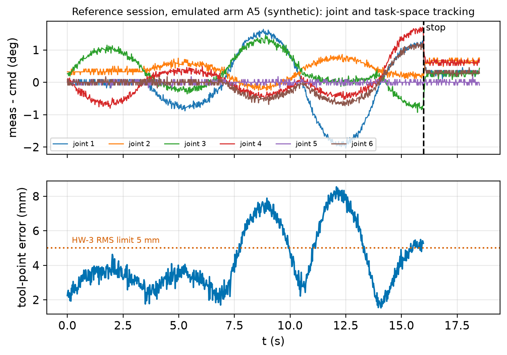
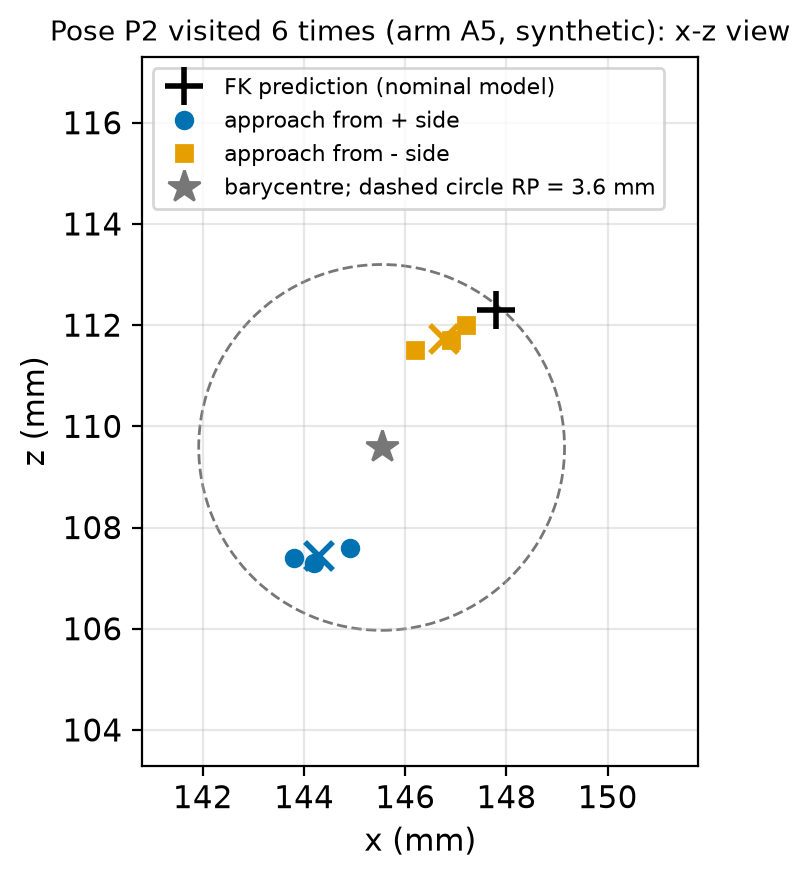

# Overview

| Item | Detail |
|---|---|
| Session | Session 4, 50 min in class (rotation between a hardware station and a simulation station) + up to 2 h to finish the analysis (due before the Week 9 lab) |
| Groups | Your **project team** of three (formed in Week 7) |
| CLOs | 361-7 (implement, test and validate kinematic algorithms against a reference library, a simulator **and physical hardware**); 361-4 (PoE forward kinematics); prepares 361-8 (project hardware runs H1, H2) |
| Before the session (required) | Pre-lab check; `check_plan` and `run_logged` implemented and passing (the **safety gate**); safety section read |
| In the session | **Hardware safety induction** for the whole class (first 10 min; your first hands-on contact with the course arm), then run the validation plan VP-1 once on a course arm (Station H) and once on an emulated arm (Station S) |
| After the session | Analysis Steps 3–6 (auto-tested on the reference data of arm A5, then applied to your two data sets) |
| Code | `starter.py` (you edit), `test_lab.py` (17 auto-checks), `run_session.py` (runs VP-1), given: `sim_arm.py`, `vendor_arm.py`, `safety_guard.py`, `course_arm_model.py` |
| Data | `data/validation_plan.json` (VP-1), `servo_offsets_A5.json`, `session_A5_log.csv`, `session_A5_tips.csv` (reference session, synthetic), `measurement_sheet.csv` (blank) |
| Reading | MR Ch. 1, pp. 1–3; MR §4.1 (pp. 138–150); MR §11.8, p. 448; Corke §7.5.1 (p. 158), §9.2 (pp. 200–201); project brief §4.1; Course resources: Course robot models and hardware safety checklist; Week 8 lecture notes Part C |
| AI use | Allowed with disclosure for the code and analysis (see Reflection); not for the pre-lab check |
| Tier | 1 (course arm, supervised) **and** 0 (emulator). If no arm is available, Station S plus the A5 data is the complete lab |

This lab adds the module `validate.py` to your `sbeg361_kinematics` library (after `fk.py` of Lab 5 and the DH
tools of Lab 6). The project hardware sessions H1 (Weeks 10–11) and H2 (Weeks 12–13) use exactly this code:
`check_plan` before every run, `run_logged` to log, and the HW-1 to HW-6 tests to compare.

**The course arm** is the shared desktop UR-type 6R (myCobot-280 class): $W_1 = 0.0634$, $W_2 = 0.0456$,
$L_1 = 0.110$, $L_2 = 0.096$, $H_1 = 0.1312$, $H_2 = 0.0751$ m, servo zero = arm straight up ("candle"), offsets
$(0, 90, 0, 90, 0, 0)^\circ$ with $q_\text{model} = q_\text{servo} - \text{offset}$ (Lab 5). The tool is the 60 mm
pointer of project scenario S3, $p_\text{tool} = (0, 0, 0.06)$ m in {b}. Rated speed, limits, servo behaviour and
all data of the emulated arms are **illustrative values**.

**Application context.** *Biomedical:* before the S3 needle guide approaches a biopsy phantom, or the S2 arm presents
a spoon, the team must show that the arm is where the model says, to well under the task tolerance (5 mm for S3).
*Defence (protective use):* an EOD or CBRN arm is teleoperated from a display drawn from FK and joint readings; field
teams re-check the zero pose after transport, because an offset that no joint log can reveal moves the gripper
millimetres from where the operator sees it.

# Learning objectives

By the end of the lab you can:

1. Check a joint trajectory against limit and speed margins before it is sent, and explain the three layers of
   protection at the station (planning check, software guard, emergency stop).
2. Log commanded and measured joint angles on a real and an emulated arm and evaluate the hardware acceptance tests
   HW-1 to HW-6 of the project brief.
3. Separate errors the servo can see (lag, droop, quantisation) from errors it cannot (backlash, zero offset), and
   estimate their effect at the tip with $\delta p = r\,\delta\theta$.
4. Measure accuracy and repeatability of a pose, detect backlash from the approach direction, and calibrate joint
   offsets by least squares, judging when a fit is trustworthy.

# Pre-lab check (complete before the session; 5 questions)

1. Name two error sources that the servo's own joint log can **not** reveal, and say why.
2. The rated joint speed is 160°/s and rotation 1 allows 25 %. A joint moves 75° with the cubic time scaling
   $s = 3\tau^2 - 2\tau^3$ in $T = 3.5$ s. Is the peak speed within the cap?
3. The arm reaches about 0.28 m and carries a 60 mm pointer. What is the minimum radius of the taped keep-out zone
   (checklist rule 2), and how far is the tape from the pointer tip at full reach?
4. A joint whose axis is 0.20 m from the pointer tip has a zero error of 0.5°. Estimate the tip error.
5. Define pose accuracy (AP) and repeatability (RP). Which one can a better calibration improve?

*Answers (for self-check):* 1. Backlash and a zero (calibration) offset: the encoder measures the servo shaft
before the gear play, and it does not know where the link's true zero is (lecture notes C.2). 2. Peak
$1.5\times75/3.5 = 32.1^\circ$/s $\le 40^\circ$/s: yes. 3. $0.28 + 0.30 = 0.58$ m; the pointer tip reaches $0.34$ m, so
the tape is still $0.24$ m beyond it. 4.
$0.20\times0.5\times\pi/180 = 1.75$ mm. 5. AP = distance from the mean attained point to the commanded (model) point;
RP = mean spread about that mean plus three standard deviations; calibration improves AP only.

# Safety (read before the session; the TA signs the checklist before the arm is powered)

**The safety induction is held here, and this is your first hands-on contact with the arm.** The course-arm
hardware safety induction (checklist rule 5) is held at the **start of this session** (Week 8, Session 4) for the
whole class. Nobody handles the arm before Week 8: any earlier hardware parts were demonstrations operated by the
instructor or a TA. Rotation 1 is therefore every student's **first hands-on contact** with the course arm; the
Week 10 Lab 8 hardware station (hardware rotation 2) and the project sessions H1 (Weeks 10–11, the first project run) and H2
(Weeks 12–13) all come after it and rely on this induction. A student who misses the induction does **not** work at
Station H today: they do Station S, use the A5 reference data for Station H, and complete a make-up induction with
a TA in Week 9, before any later hardware session. Because this is a first contact, rotation 1 also uses the
**session rules for rotation 1** below: a fixed, pre-checked plan (VP-1), only the TA moves the arm by hand or
works inside the keep-out zone (arm powered down), and nobody is inside the zone while the arm is powered. These rules add to the
shared checklist; they never relax it.

**Shared course-arm checklist** (quoted word for word from Course resources: Course robot models and hardware safety
checklist, section "Hardware safety checklist for the course arm (all three courses)"; the same checklist is quoted in
project brief §4.1):

| # | Rule | Value |
|---|---|---|
| 1 | Software joint limits inside the hardware limits | margin ≥ 10° on every joint (hardware limits ±165°, J6 ±175° → software limits ≤ ±155°, J6 ≤ ±165°) |
| 2 | Taped keep-out zone around the base | radius = reach + 0.3 m ≈ 0.28 + 0.30 = 0.58 m |
| 3 | Joint speed | ≤ 25 % of rated (≤ 40 °/s) on the first run of any new motion and throughout SBEG 361 session H1; ≤ 50 % of rated (≤ 80 °/s) otherwise |
| 4 | Payload | ≤ 50 % of the rated 0.25 kg, i.e. ≤ 0.125 kg, unless the department approves an exception |
| 5 | Induction | every person who touches the arm has completed the hardware safety induction before their first hands-on run |
| 6 | Keep-out discipline | nobody is inside the keep-out zone while the arm can move; a hand may enter for a measurement only with the arm in latched stop and torque disabled (or power removed), with the safety officer's approval |
| 7 | Before every session | emergency stop tested; supervisor present for the whole run |

> The derated current limit (≤ 60 % of rated, table above) also applies.

("Table above" is the rated-values table in Course resources: Course robot models and hardware safety checklist.)

**Session rules for rotation 1 (TA signs each line before the arm is powered).**

- [ ] *Induction (rule 5).* Every team member at Station H has read this section and Week 1 notes §1.5 **and
      completed the hardware safety induction at the start of this session** (TA signs the induction register). Only inducted
      students work at Station H. Hands-on tasks for students today, all under the TA's eye: testing the emergency
      stop, holding it during the run, operating the laptop, and checking the pointer and cameras by eye with the
      arm **powered down**. The TA mounts the pointer, places the cameras and is the only person who moves the arm
      by hand.
- [ ] *Keep-out zone (rules 2 and 6).* Taped at radius ≥ 0.58 m about the joint-1 axis; bench clear. **Nobody,
      student or TA, is inside the zone while the arm is powered.** The rule-6 exception (a hand inside with torque
      disabled) is **not used** in rotation 1: tip positions are read from camera photos (procedure below).
- [ ] *Speed and limits (rules 1 and 3).* VP-1 is a first run, so speed ≤ 25 % of rated (40°/s); software limits
      ±155° (joint 6 ±165°) in model angles; both enforced by `safety_guard.py` and checked by your `check_plan`.
- [ ] *Payload (rule 4).* Only the 60 mm pointer, fixed securely; nothing else on the flange; no liquids, no sharp
      tools.
- [ ] *Before the session (rule 7).* Emergency stop (button or power switch) within reach of the stop person and
      **tested** at the start; the TA is present for the whole run and supervises at most two arms.
- [ ] Your `check_plan` and `run_logged` pass their tests (`run_session.py` checks this and refuses otherwise);
      dry run of VP-1 done on the emulator by your team before the session.
- [ ] Video recording; stow pose known; arm powered down and bench clear at the end.

**Roles at Station H.** One named **operator** (laptop), one **stop person** (hand on the emergency stop at all
times while the arm is powered), one **recorder** (measurement sheet, camera photos, video with a ruler in view).
The TA supervises at most two arms.

**Measurement procedure (no entry while powered).** (1) Before the arm is powered, the TA fixes a **top camera** on
a stand vertically above the 1 mm grid and a **side camera** at the bench edge, outside the tape, level with the
vertical scale next to the grid; nothing is moved inside the zone after power-on. (2) The arm arrives and settles.
(3) `run_session.py` puts the arm into a **latched stop** (motion commands are refused until reset) and says so on
the screen. (4) The recorder triggers both cameras from outside the zone and reads $x, y$ from the top photo and
$z$ from the side photo; the TA checks the reading. (5) Only then is the stop reset. If a camera or the grid has to
be adjusted, the arm is first powered down. A stop called by anyone, at any time, is obeyed without discussion.

# Setup (before the session)

```bash
cd "<your Lab code folder>"                                     # or your Classroom 50 repo
source ~/Documents/Edu/Lectures/Robotics/MR-Studio/.venv/bin/activate   # or the course Docker image / JupyterHub
LAB_IMPL=starter python -m pytest -q test_lab.py                 # 13 failures (NotImplementedError) expected
```

On Windows (PowerShell) use `$env:LAB_IMPL="starter"; python -m pytest -q test_lab.py`. Rules: do **not** import
`modern_robotics`, `scipy` or `course_arm_model` in `starter.py`. The helpers at the top of `starter.py`
(`screw_exp`, `fk_space`, `tool_points`, `servo_to_model`, `smooth_segments`, `read_log`, `write_log`,
`read_tips`, ...) are complete; `screw_exp(S, theta)` is the Lab 5 helper (equal to your Lab 4 `matrix_exp6(se3mat)` called as
`matrix_exp6(vec_to_se3(S) * theta)`), and you may replace `fk_space` by your Lab 5 version. Four tests check the given files
and pass from the start.

# Part A — Before the arm moves (safety gate; complete before the session)

## Step 1 — Plan check (8 min)

Implement `check_plan(t, q_servo_deg, offsets_deg, soft_limits_deg, rated_deg_s, speed_fraction, margin_deg)`:
convert to model degrees, compute each joint's smallest margin to the software limits and its peak speed
(`np.gradient`), and return the flags `ok_limits`, `ok_speed`, `ok`.

Check it on VP-1: `smooth_segments` through R–P1–P2–P3–P4–R with $T_\text{seg} = 3.5$ s at 50 Hz gives an 18.5 s
plan with peak speeds $(32.14,\ 8.57,\ 17.14,\ 25.71,\ 0,\ 19.29)^\circ$/s and margins of at least 35° (joint 4).

**Checkpoint 1:** `test_check_plan_margins_and_speeds`, `test_check_plan_rejects_limit_margin`,
`test_check_plan_on_validation_plan_and_reference_log`.

## Step 2 — Logged run (10 min)

Implement `run_logged(arm, t, q_cmd_servo_deg, stop_at=None)`. For each sample: wait until $t_k$; at the first sample
with $t_k \ge$ `stop_at` call `arm.stop()`; while not stopped, send the command (if the guard raises
`SafetyViolation`, call `arm.stop()` and record the message in `aborted`); read the measured angles; store the last
command actually sent, the measurement and the stop flag. The same function runs on `SimArm` (virtual time) and on
`VendorArm` (real time).

**Checkpoint 2:** `test_run_logged_order_and_stop_with_fake_arm`, `test_run_logged_aborts_on_safety_violation`,
`test_run_logged_on_emulator_and_guard`. Then do the **dry run** of the whole plan on your assigned emulated arm:

```bash
python run_session.py --backend sim --arm S3 --team T07 --out ../my_data     # your arm id and team id
```

It writes `log_<arm>_<date>_<team>_run1.csv` (format of the project's `hwcompare.py`), `tips_...csv` and a `.json`
with the metadata. If the trajectory is refused or aborted, fix your code before Thursday.

# Part B — In the session: run VP-1 at both stations (induction, then 2 × 18 min)

The class is split in two halves. Half 1 starts at Station H (course arms A1–A6), half 2 at Station S (emulated arms
S1–S6, laptops) after the induction; after 18 minutes the halves swap. During Station S the TAs hold a 3-minute project stand-up with
each team.

| Time | Station H (hardware, supervised) | Station S (emulator) |
|---|---|---|
| 0:00–0:10 | Whole class: **hardware safety induction** (checklist rule 5; emergency-stop demonstration and test, keep-out discipline, roles, "anyone may call stop"); TA signs the induction register | same |
| 0:10–0:28 | Half 1 | Half 2 |
| 0:28–0:46 | Half 2 | Half 1 |
| 0:46–0:50 | Power down, files copied, fault log, bench clear | files copied |

**At Station H.**

1. *Checklist and zero-pose check (3 min).* TA signs the checklist; the stop person tests the emergency stop (rule 7). With the vendor tool, move the arm at low speed to
   its servo-zero (candle) pose and check verticality on the side-camera image against the vertical scale (from
   outside the zone); note any visible offset in the metadata.
2. *Run VP-1 (13 min).* The TA starts (the script runs your safety tests first and asks for `GO`):
   ```bash
   python run_session.py --backend vendor --port <port> --arm A3 --team T07 --offsets data/servo_offsets_A5.json --out ../my_data
   ```
   The A5 file holds the nominal offsets $(0, 90, 0, 90, 0, 0)^\circ$; use your arm's own calibration file instead if
   the TA has one. **Block 1** moves to the ready pose R and runs the logged trajectory R–P1–P2–P3–P4–R; the stop command is given
   automatically at $t = 16.0$ s during the last segment (HW-6). After the stop, the operator resets on the TA's word.
   **Block 2** visits P1–P4, each approached from the + side (pre-point $+5^\circ$ on every joint); at each pose the
   arm settles 1 s and goes into the latched stop; the recorder takes the two photos and reads the pointer tip from
   outside the zone: $x, y$ on the 1 mm grid (top camera, vertically above to avoid parallax), $z$ on the vertical
   scale (side camera); the operator types the three numbers.
   **Block 3** visits P2 six times, alternately from the + and − side (pre-point $\pm5^\circ$).
3. *Wrap up (2 min).* Arm to stow pose on the operator's command, power down, copy files, note any incident in the
   fault log (date, arm, symptom, what was tried, TA signature).

Estimate your measurement uncertainty (grid and scale reading on the photos, camera parallax) and write it in the metadata. If the session
cannot be completed because of an equipment fault, record it in the fault log; the analysis is then done on the
emulator data and the A5 data, and you are re-booked for a later supervised slot if one is available.

**At Station S.** Run the same command with `--backend sim --arm <S1…S6>` (the TA assigns the arm id). The emulator
measures the tip with a noise of about 0.4 mm per axis. Use the remaining time for the stand-up and to start Step 3.

# Part C — Analysis (after the session; auto-tested on the A5 reference data)

Implement the remaining functions and check them on the reference session of emulated arm A5 (`data/session_A5_*`,
synthetic, made by the instructor with the emulator and the procedure of Part B). Then run the same analysis on **your** Station H and
Station S files.

```python
import numpy as np, starter as lab
from course_arm_model import course_arm_reference      # allowed in your notebook, not in starter.py
M, S, _ = course_arm_reference()
plan = lab.load_plan("data/validation_plan.json"); off = lab.load_offsets("data/servo_offsets_A5.json")
log = lab.read_log("data/session_A5_log.csv"); tips = lab.read_tips("data/session_A5_tips.csv")
```

## Step 3 — Joint space, task space, limits, speed, stop (12 min)

Implement `joint_tracking` (HW-2), `task_tracking` (HW-3) and `stop_check` (HW-6); HW-4 and HW-5 are `check_plan`
applied to the **measured** angles.

a. **HW-2.** On A5 (800 samples before the stop): RMS errors $(0.93,\ 0.43,\ 0.64,\ 0.54,\ 0.06,\ 0.42)^\circ$, maxima
   $(2.03,\ 0.86,\ 1.45,\ 1.70,\ 0.18,\ 1.22)^\circ$, mean errors of joints 2 and 3 $+0.35^\circ$ and $+0.33^\circ$. Plot
   $e_j(t)$. Which joints show an error that follows the **speed**, and what servo time constant does joint 1 suggest
   (peak 37°/s, max error 2.0°)? Which joints show a **constant** error, and why is its sign physically plausible
   (which way does gravity turn joints 2 and 3 when the arm reaches forward)?
b. **HW-3.** Tool-point error between FK of commanded and measured angles: RMS 4.67 mm, max 8.54 mm. Pass, but with
   little margin. What would you change in the plan to gain margin, and what would it cost?
c. **HW-4, HW-5.** Smallest measured margin 35.0° (joint 4); peak measured speed 37.4°/s = 23 % of rated. Why is the
   measured peak higher than the planned 32.1°/s?
d. **HW-6.** Stop at 16.0 s; the joints stay within 0.3° of their rest pose after 0.06 s; largest motion after the
   command 0.79°. Explain why `stop_check` compares with the **median of the last 0.5 s** instead of using
   finite-difference speeds on a quantised, noisy log.

**Checkpoint 3:** `test_joint_tracking_reference_log`, `test_task_tracking_matches_modern_robotics`,
`test_stop_check_reference_and_synthetic`.



## Step 4 — Is the arm where the model says? Accuracy and repeatability (12 min)

Implement `hw_tip_errors_mm` (HW-1), `accuracy_repeatability` and `backlash_split`.

a. **HW-1.** FK prediction from the servo readings versus the measured tip at P1–P4: about
   $(4.24,\ 4.10,\ 4.50,\ 3.97)$ mm, RMS 4.21 mm. HW-1 passes (≤ 10 mm). Would you accept it for the 5 mm S3 target?
b. **Repeatability at P2** (six visits, reference point = FK of the commanded P2): $\mathrm{AP} = 3.90$ mm,
   $\mathrm{RP} = 3.61$ mm over all six visits, but RP is only 1.26 mm (+ side) and 1.25 mm (− side) when each
   direction is taken alone; the two barycentres are 4.96 mm apart. What causes the split, and why can the servo log
   not show it? The AP of the + visits is 6.25 mm, that of the − visits 1.93 mm: what does this tell you about
   approach directions in a clinical or EOD task?

**Checkpoint 4:** `test_hw_tip_errors_reference`, `test_accuracy_repeatability_small_case_and_reference`.



## Step 5 — Calibrate joint offsets, and judge the fit (12 min)

Implement `fit_offsets` (Gauss–Newton with a central-difference derivative; Week 9 gives this derivative in closed
form as the Jacobian). Use the four accuracy poses only.

| Joints fitted (1-based) | $\delta$ (deg) | RMS after (mm) |
|---|---|---|
| none | — | 4.21 |
| 2 | 0.74 | 3.18 |
| 3 | 1.17 | 1.55 |
| 2, 3 | $-0.61,\ 1.74$ | 1.03 |
| 2, 3, 4 | $0.24,\ -0.06,\ 1.66$ | 0.93 |

a. Which model would you keep? Compare the RMS gain with how much the estimates change when joint 4 is added. With
   only four poses (12 numbers) and pointer-down poses, which offsets are hard to separate?
b. **Cross-check** on data not used in the fit: with the (2, 3) offsets (new calibration $90.61^\circ$ and
   $-1.74^\circ$ for joints 2 and 3), the six P2 visits have mean errors 0.88 mm (+ side) and 5.11 mm (− side). Explain
   with Step 4b why a calibration made with one approach direction "absorbs" half the backlash, and how you would
   calibrate for a task that approaches from both sides.
c. Why can joint 6 never be identified from these data? (Look at $\mathcal B_6$ and the pointer direction; Lab 5,
   Step 5c.)

**Checkpoint 5:** `test_fit_offsets_recovers_known_errors`.

## Step 6 — Error budget (6 min)

Implement `error_budget(M, S, theta, p_tool, dtheta_deg)` (lecture notes C.3): move each home axis with
$T_{j-1}$, take the distance of the tip from it, and scale by the joint error.

a. At P2 the lever arms are $(0.2167,\ 0.2081,\ 0.2091,\ 0.1296,\ 0.1056,\ 0)$ m. For 12-bit quantisation
   (0.0879°) the budget is 1.33 mm worst case, 0.62 mm RSS. Compare with the HW-1 error of Step 4a: which sources
   dominate?
b. Use `error_budget` with the backlash you inferred in Step 4b to check that it explains the split.

**Checkpoint 6:** `test_error_budget_matches_jacobian_columns`. Finally run the whole suite:
`LAB_IMPL=starter python -m pytest -q test_lab.py` must show **17 passed** (16 passed and 1 skipped in a student copy
of the lab, where the shared-model check is skipped).

# Deliverables (auto-checked notebook lab; not a formal report)

Submit to your team repository before the Week 9 lab (one submission per team; every member must be able to explain
every line):

1. `starter.py` (your `validate.py`) with all functions implemented; the full test suite passes.
2. Your data: the Station H and Station S logs, tip files and metadata, the completed checklist (photo) and the fault
   log entry if any.
3. A notebook or PDF (≤ 4 pages): answers to Steps 3–6 for the A5 data **and** the same table of results (HW-1 to
   HW-6, AP, RP, split, fitted offsets, budget) for your hardware arm and your emulated arm, with a short paragraph
   comparing the two and the measurement uncertainty you estimated.
4. The reflection below.

Marking (lab category): tests 40 %, own data and results table 30 %, answers 15 %, reflection 15 %. Be prepared for a
2-minute oral check on any line of your code.

# Reflection (≤ 200 words)

- Your arm passed HW-1 at about 4 mm. For which of the six project scenarios is that good enough, and for which not?
- Which error would you reduce first for your own project scenario, and how (calibration, approach direction, slower
  motion, a better measurement)?
- What did the three layers of protection do during your session? Did any of them act?
- **AI-use note (required):** state which AI tools you used (or "none"), what you asked, and what you kept or changed.

# Troubleshooting

| Symptom | Likely cause and fix |
|---|---|
| `run_session.py` says the safety-critical tests failed | Fix `check_plan` / `run_logged` until Checkpoints 1–2 pass; the arm will not move otherwise. |
| `SafetyViolation: ... rate ... > cap` during your own test | Your plan jumps between samples: check the time vector (seconds, not samples) and the segment time. |
| `SafetyViolation: ... outside software limits` | A pose or pre-point is within 10° of a hardware limit; the plan is wrong, not the guard. |
| `run_logged` test: "send after stop" | You keep sending after `arm.stop()`; set a flag and skip the send. |
| HW-6 halt time is `inf` | The log ends while the arm is still moving, or you used raw finite-difference speeds; use the median rest pose. |
| `hwcompare.py` reports a long HW-6 halt time on your log | Its speed threshold is sensitive to encoder noise; report HW-6 with `stop_check` of this lab and say so. |
| HW-1 errors of 100+ mm | Offsets added instead of subtracted, or degrees not converted to radians. |
| `fit_offsets` diverges or gives tens of degrees | Wrong sign convention (corrected offset = offset − δ), or too large a finite-difference step. |
| Reading on the grid jumps by 1–2 mm | Parallax: the top camera must look vertically down at the pointer tip (re-level it only with the arm powered down); take the mean of two readings. |
| Vendor SDK not found on the station laptop | The TA adjusts `vendor_arm._open_sdk` for the installed SDK; meanwhile use Station S. |
| Servo returns no angles (communication glitch) | `VendorArm.read` repeats the last good reading; if it persists, stop, record in the fault log, call the TA. |

# C++ track

You may do the code of this lab in C++17 instead of Python. The functions, data files, checkpoints and deliverables
are the same; the auto-checks compare your results with `mrcpp` (the C++ port of `modern_robotics` in the course
folder `cpp_support`), with the same emulator and with the numbers of the Python reference, so both tracks are
marked against identical values.

**The session itself stays in Python, so the safety gate is written in both languages.** The course arm's vendor SDK
is a Python package, and `run_session.py` (both stations) calls the Python `check_plan` and `run_logged` of
`starter.py`; on the hardware backend it runs the Python safety tests first and refuses to move the arm if they fail.
A C++-track team therefore also implements these two functions in `starter.py` (about 25 lines; Checkpoints 1–2 of
the Python suite, `LAB_IMPL=starter python -m pytest -q test_lab.py -k "check_plan or run_logged"` must pass) before
the session. Everything else — the same two functions in C++ and all of Part C — is done in C++.

**Files** (in the `cpp` sub-folder of your Lab code folder): `starter.cpp` (your work), `lab.hpp` (declarations and
documentation — do not change), `test_lab.cpp` (auto-checks, doctest), `cpp_cases.json` (reference numbers),
`CMakeLists.txt`, and given code you do not edit: `arm_station.hpp` / `arm_station.cpp` (C++ copies of
`course_arm_model.py`, `safety_guard.py` and `sim_arm.py`: the course arm model, the `SafetyGuard`, the `Arm`
interface and the emulator `SimArm`) and `analyse_session.cpp` (prints the Part C results table using your functions).
The data files are the same files in `data/`. `cpp_support` (Course resources) must sit next to your lab folders or in
a parent folder of them (the build finds it automatically up to 6 levels up).

**Requirements.** A C++17 compiler — Windows: Visual Studio Build Tools (2022 or 2026), workload "Desktop development with
C++"; macOS: `xcode-select --install`; Ubuntu: `sudo apt install build-essential`. CMake and Ninja come with
`pip install cmake ninja` (both are in the course `requirements.txt`).

**Build and run** (from your Lab code folder):

```bash
python run_lab.py hw1 --cpp                    # configure, build, run, print Score: k/n
# or directly:
cmake -S cpp -B build -G Ninja
cmake --build build
./build/lab_tests                              # Windows: build\lab_tests.exe
./build/lab_tests -tc="*check_plan*,*run_logged*"   # only some tests (like pytest -k)
./build/analyse_session                        # Part C table for the A5 reference data
./build/analyse_session ../my_data/log_S3_<date>_T07_run1.csv ../my_data/tips_S3_<date>_T07.csv data/servo_offsets_A5.json
```

With the untouched starter, the programs build and all 13 test cases fail with `TODO: <function>`: this is
expected. Rebuild (`cmake --build build`) after every change. `analyse_session` takes the log and tips files written
by `run_session.py` (and the offsets file used in the session) and prints HW-1 to HW-6, AP, RP, the backlash split,
the offset fits of the Step 5 table and the error budget at P2; use these numbers in your report.

**Functions to write** (in `starter.cpp`, same order as in Python): `check_plan` (Step 1), `run_logged` (Step 2),
`joint_tracking`, `task_tracking`, `stop_check` (Step 3), `hw_tip_errors_mm`, `accuracy_repeatability`,
`backlash_split` (Step 4), `fit_offsets` (Step 5), `error_budget` (Step 6, the version with one error per joint).
Given and complete, as in `starter.py`: `vec_to_so3`, `screw_exp`, `fk_space`, `tool_points`, `servo_to_model`, `model_to_servo`,
`load_offsets`, `load_plan`, `smooth_segments`, `write_log`, `read_log`, `read_tips`, `before_stop` (= `_before_stop`),
the `error_budget` overload with one scalar error, and two NumPy replacements: `gradient` (= `np.gradient(F, t,
axis=0)`) and `median` (= `np.median`). Do not call `mrcpp` or `course_arm_reference` in `starter.cpp` (the same rule as
for `modern_robotics` and `course_arm_model` in Python).

**Checkpoints.** 1: `./build/lab_tests -tc="*check_plan*"`; 2: `-tc="*run_logged*"`; 3:
`-tc="*joint_tracking*,*task_tracking*,*stop_check*"`; 4: `-tc="*hw_tip*,*accuracy*"`; 5: `-tc="*fit_offsets*"`;
6: `-tc="*error_budget*"`; finally all 13 test cases pass (`./build/lab_tests`). The Python track counts 17 tests:
its four extra tests check the given Python files (shared-model copy, safety guard, vendor adapter, emulator) and
pass from the start; the C++ track checks the C++ copy of the course arm model inside the `task_tracking` test case.

**Differences from the Python version.**

| Python | C++ |
|---|---|
| a `dict` result (`r["margin_deg"]`, `log["meas"]`) | a small struct with the same field names (`r.margin_deg`, `log.meas`), declared in `lab.hpp` |
| `log["aborted"]` is `None` or a message | `std::optional<std::string> aborted`: `if (log.aborted) ... *log.aborted` |
| `stop_at=None` | `std::optional<double> stop_at` (default empty): `if (stop_at && t(k) >= *stop_at)` |
| `arm` with `wait_until`, `send`, `read`, `stop`; `except SafetyViolation as exc` | `lab::Arm& arm` (interface in `arm_station.hpp`); `catch (const SafetyViolation& e)`, message `e.what()` |
| `np.gradient(q, t, axis=0)`, `np.median` | given helpers `gradient(q, t)`, `median(v)` |
| `np.linalg.lstsq(J, -r)` | `J.completeOrthogonalDecomposition().solve(-r)` |
| `l.std(ddof=1)` | write it: divide the sum of squared deviations by $m-1$ |
| `np.inf` | `std::numeric_limits<double>::infinity()` (`<limits>`) |
| `joints=(1, 2)` (0-based) | `std::vector<int>{1, 2}` |
| `dtheta_deg` scalar or array | two overloads: `double` (given) or `Eigen::VectorXd` (yours) |
| `raise ValueError(...)` | `throw std::invalid_argument("...")` |
| emulator noise from NumPy | C++ random generator: individual noisy readings differ from Python; the noise statistics and the noise-free motion are identical |
| notebook for Part C | `./build/analyse_session` prints the table; plots stay in Python (your notebook can read the same CSV files) |

A matrix-size mistake (e.g. subtracting a 6-vector from a $N\times6$ matrix without `.rowwise()`) does not crash the
test program: it is reported as a failed test with the message "Eigen: wrong matrix size or index out of range".

**C++ troubleshooting.**

| Symptom | Likely cause | Fix |
|---|---|---|
| `cpp_support not found` | the course folder `cpp_support` is not next to / above your Lab code folder | copy it there, or configure with `-DSBEG_CPP_SUPPORT=<path>` |
| `No CMAKE_CXX_COMPILER could be found` | no C++ compiler installed | install it (see Requirements); on Windows run from the "x64 Native Tools Command Prompt" if Ninja cannot find `cl` |
| `cannot open file: .../cpp_cases.json` | Lab code folder moved after configuring | delete the `build` folder and configure again |
| `run_logged` test: "send after stop" | you keep sending after `arm.stop()` | set a flag and skip the send |
| `run_logged` emulator test: `aborted` empty, "rate" expected | the `SafetyViolation` is caught but not stored, or caught as a different type | `catch (const SafetyViolation& e) { arm.stop(); stopped = true; log.aborted = e.what(); }` |
| peak speeds slightly off | own difference formula instead of `gradient` | use the given `gradient(q, t)` (same as `np.gradient`) |
| `fit_offsets` diverges or tens of degrees | sign convention (corrected offset = offset − δ) or residual flattened column by column | flatten row by row: $(x_1, y_1, z_1, x_2, \dots)$ |
| `analyse_session: cannot open file` | path relative to the wrong folder | paths are relative to the folder you run the program from |
| Tests still show your old result | program not rebuilt | `cmake --build build` before `./build/lab_tests` |
