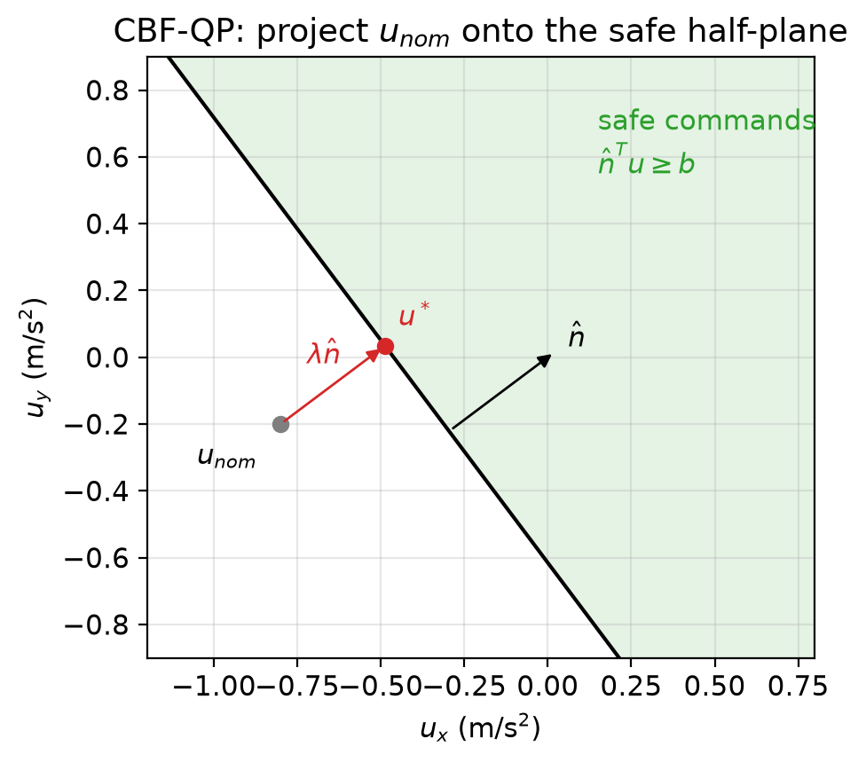
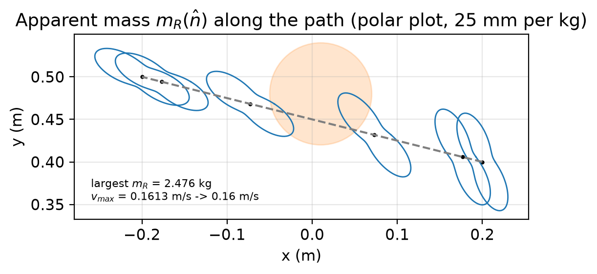
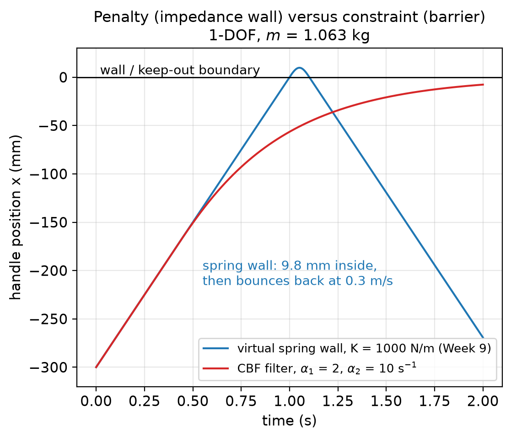
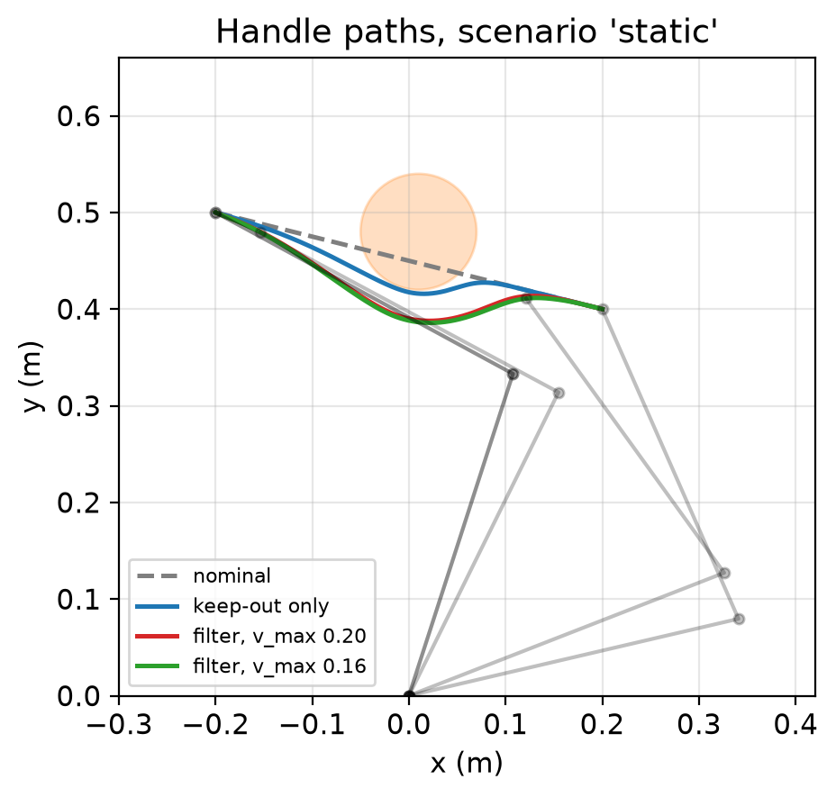

# How to use this package

This is an **optional** enrichment package. It follows Week 12 (after the planning weeks 11–12), uses the force, hybrid
and impedance control of Week 9 and the safety numbers of Week 13 (stopping distance, speed and separation, power and force limiting with the reduced mass). It
needs about 6–8 hours: 3 hours to read this guide and the slides, 1–2 hours for the five problems, and 2–3 hours for the
lab. Nothing in it is examined in the final paper. The lab can be submitted for the coursework bonus of Course syllabus §4
(+1 % or +2 %, within the +2 % bonus cap; deadline and oral-check slots in `rubric.md`). It can also guide the barrier in
the safety section of a course project (Scenario 1, rehabilitation robot; Scenario 6, casualty-handling arm; no separate
mark), or serve as a first step towards SBEG 46X.

**Prerequisites.** Error dynamics and computed torque (Weeks 5–6, MR §11.4), task-space dynamics and apparent mass
(Week 4, MR §8.6), impedance control and the stiffness–delay limit of a virtual wall (Week 9, MR §11.7). **Sections 7
and 9 depend on Week 13:** they use Week 13 Lecture A §4 (safety-rated monitoring) and the Week 13 lecture notes
§§4.2–4.5 (stopping distance and speed limits, power and force limiting, the watchdog, independence). Read those notes before Sections 7 and 9,
that is, do Sections 1–6 and 8 after Week 12 and Sections 7 and 9 after Week 13 Lecture A; the bonus deadline (start of
Week 14) leaves time for this.

**What you will be able to do.**

1. Define a safe set by a barrier function $h(x) \ge 0$ and prove that it is forward invariant (CLO 461-6).
2. Write the control barrier function (CBF) condition, including the second-order form needed for robots, and turn it
   into a quadratic program (QP) that filters a nominal controller (CLO 461-6, 461-7).
3. Implement a CBF-QP safety filter on top of task-space computed torque for a rehabilitation robot, keep its handle out
   of a region around a person and cap its approach speed (CLO 461-7).
4. Derive the approach-speed limit from the power-and-force-limiting model of Week 13 and the apparent mass of the arm
   (CLO 461-3, 461-7).
5. Compare barriers with impedance control (virtual walls) and passivity, and state what a software barrier cannot do
   (CLO 461-7, 461-9).

Notation follows *Modern Robotics* (MR). Page numbers are printed pages of the December 2019 preprint. All robot and
human-body numbers are **illustrative values**; the robot is the shared course model `rehab_2r` (see "Course resources:
Course robot models and hardware safety checklist").

| Topic | Reading in the course library |
|---|---|
| Computed torque, Eq. 11.37; PD + gravity compensation and its Lyapunov function, Eqs. 11.38–11.43 | MR §11.4.2.2, pp. 434–435 |
| Task-space motion control, Eq. 11.47 | MR §11.4.3, pp. 435–436 |
| Task-space dynamics $\Lambda(\theta)$, $\eta(\theta,\mathcal V)$, Eqs. 8.89–8.91 | MR §8.6, pp. 298–299 |
| Skew symmetry of $\dot M - 2C$ (passivity property), Proposition 8.1 | MR §8.1.2, p. 277 |
| Impedance control, Eqs. 11.62–11.65 | MR §11.7, pp. 443–447 |
| Lyapunov functions; Krasovski–Lasalle principle and invariant sets, Theorem 4.4 | Åström–Murray, *Feedback Systems*, §4.4, pp. 110–118 (invariant set: p. 118) |
| Passive systems and the passivity theorem | Åström–Murray §9.5, pp. 287–288 |
| Barrier functions, Theorem 9.5 | Tedrake, *Underactuated Robotics*, Ch. 9 *Lyapunov Analysis*, §9.1.6 (p. 154 of the library PDF) |
| Stopping distance, speed and separation, power and force limiting | Week 13 lecture notes §§4.2–4.5 |
| Virtual walls, stiffness–delay limit | Week 9 lecture notes §6.2 and WE8 |

Control barrier functions themselves are **not** treated in the library books. The standard sources, named in full in
Section 15, are Ames et al. (2014, 2017, 2019) and Nguyen and Sreenath (2016). You do not need them for this package.

# 1. Why another safety tool?

Weeks 9 and 13 gave three ways to keep a robot safe near a person:

* **Shape the interaction** (Week 9). An impedance controller makes the robot feel like a soft spring and damper. A
  virtual wall pushes back when the handle goes too far. This is a *penalty*: the handle must first enter the wall
  before any force acts, and the wall stiffness is limited by sampling and delay (Week 9 §6.2).
* **Stop when a limit is crossed** (Week 13). A safety-rated monitor watches speed, position and force and stops the
  robot. This is reliable and independent, but it is a last resort: the task ends.
* **Limit speed near people** (Week 13). Speed and separation monitoring and power and force limiting give *numbers*
  (for example 0.20 m/s for the tele-rehabilitation robot) but not a controller that respects them.

What is missing is a controller that **does the task as well as it can while never leaving a safe set**. Control
barrier functions give this. A nominal controller (here, task-space computed torque from Week 6) decides what the robot
would like to do. A small optimisation, the **safety filter**, changes that command as little as possible so that a
safety condition can never be violated — but only when the robot is close to violating it. While the robot is far from
the person and not approaching faster than the allowed speed, the filter does nothing.


The running example is the planar rehabilitation robot of project Scenario 1 (`rehab_2r`, Weeks 9 and 13). The patient holds
the handle, which follows a reaching movement from $p_A = (0.20, 0.40)$ m to $p_B = (-0.20, 0.50)$ m in 2 s. The
therapist rests a hand on the table near the path to steady the patient's elbow. The handle must never come within
$r = 0.06$ m of the centre of the therapist's hand, and it must never approach that hand faster than a speed $v_{max}$
at which an accidental contact would be harmless.

# 2. Safe sets and forward invariance

Let $x$ be the state of a system $\dot x = F(x)$. A **safe set** is written as the zero-superlevel set of a smooth
function $h$:

$$\mathcal C = \{x : h(x) \ge 0\},\qquad \partial\mathcal C = \{x : h(x) = 0\}.$$

For the keep-out disc, $h$ is the distance from the handle to the boundary of the disc, $h = |p - p_o| - r$: positive
outside, zero on the boundary, negative inside.

$\mathcal C$ is **forward invariant** if every trajectory that starts in $\mathcal C$ stays in $\mathcal C$ for all
$t \ge 0$. This is the same idea as the invariant sets used with Lyapunov functions (Åström–Murray §4.4, p. 118, where a
set $M$ is invariant if $x(t; b) \in M$ for all $t \ge 0$ whenever $b \in M$). Tedrake (§9.1.6, Theorem 9.5) states the
simplest barrier result: if a function $B(x)$ satisfies $\dot B(x) \le 0$ everywhere, the state never reaches values
$B > B(x(0))$, so a level set of $B$ is a *barrier* that separates the start from a failure region. With $h = -B$ this
says: if $\dot h \ge 0$, $h$ can never decrease, so the safe set is invariant.

That condition is too strong for a robot: it forbids moving **towards** the boundary at all, even from far away. The
barrier condition used in practice lets $h$ decrease, but more and more slowly as the boundary is approached:

> **Key result — barrier condition.** If along every trajectory
> $$\dot h(x) \ge -\alpha\, h(x),\qquad \alpha > 0,$$
> then $h(t) \ge h(0)\,e^{-\alpha t}$. A trajectory that starts in $\mathcal C$ ($h(0) \ge 0$) stays in $\mathcal C$, and
> it can approach the boundary only exponentially, never cross it.

*Proof.* $\frac{d}{dt}\big(e^{\alpha t}h\big) = e^{\alpha t}(\dot h + \alpha h) \ge 0$, so $e^{\alpha t}h(t) \ge h(0)$. $\square$

Far from the boundary ($h$ large) the condition allows $h$ to fall quickly; on the boundary ($h = 0$) it requires
$\dot h \ge 0$, so the state cannot leave. In the general theory $\alpha h$ is replaced by any *extended class-$\mathcal K$*
function $\alpha(h)$ (continuous, strictly increasing, $\alpha(0) = 0$); a constant gain is enough for this package.

## WE1 — A velocity-controlled rail (biomedical)

*A wrist-rehabilitation trainer moves its handle along a straight rail with a velocity-controlled drive, $\dot x = u$
(MR §11.3: motion control with velocity inputs). The end of safe travel is $x_{max} = 0.40$ m. The nominal command is a
constant $u_{nom} = 0.25$ m/s from $x(0) = 0$. Use $h = x_{max} - x$ and $\alpha = 2$ s$^{-1}$.*

The barrier condition $\dot h = -u \ge -\alpha(x_{max} - x)$ is a bound on the input: $u \le \alpha(x_{max} - x)$. The
safe command closest to $u_{nom}$ is

$$u = \min\big(u_{nom},\ \alpha(x_{max} - x)\big).$$

* The filter becomes active when $\alpha(x_{max} - x) = u_{nom}$: at $x = 0.40 - 0.25/2 = 0.275$ m, reached at
  $t = 0.275/0.25 = 1.1$ s.
* After that, $\dot h = -\alpha h$, so $h(t) = 0.125\,e^{-2(t - 1.1)}$. The handle comes within 1 mm of the end at
  $t = 1.1 + \ln(125)/2 = 3.514$ s and never reaches it.


The filter is a **speed limit that depends on the distance**: $u \le \alpha h$. Section 7 shows that this is exactly
what speed and separation monitoring asks for.

# 3. Control barrier functions

For a system with inputs, $\dot x = f(x) + g(x)u$ (control-affine, as robot dynamics are), the derivative of $h$ is

$$\dot h = \underbrace{\nabla h^T f(x)}_{L_fh(x)} + \underbrace{\nabla h^T g(x)}_{L_gh(x)}\,u .$$

**Definition (Ames et al., 2017).** $h$ is a **control barrier function** on $\mathcal C$ if for every state $x$ there is
an admissible input $u$ with

$$L_fh(x) + L_gh(x)\,u \ \ge\ -\alpha\,h(x). \tag{CBF}$$

The set of safe inputs at $x$ is then never empty, and **any** (Lipschitz) controller that always picks its input from
this set keeps $\mathcal C$ forward invariant, by the key result of Section 2. The CBF plays for safety the role that a
control Lyapunov function plays for stability: one certifies that the system can be kept *inside* a set, the other that
it can be brought *to* a point.

Two remarks matter for robots.

* **The condition is linear in $u$.** For fixed $x$ it is a half-space in input space. This is what makes the filter of
  Section 4 a tiny quadratic program.
* **$u$ must appear in $\dot h$.** If $L_gh(x) = 0$, the condition cannot be enforced by the input at that state. For a
  robot whose input is torque or acceleration and whose $h$ depends only on position, $L_gh \equiv 0$: the **relative
  degree** of $h$ is two. Section 5 deals with this.

# 4. The CBF-QP safety filter

Given a nominal command $u_{nom}$ (from any controller), the filter solves

$$u^* = \arg\min_u\ \tfrac12\,|u - u_{nom}|^2\quad\text{subject to}\quad a^Tu \ge b, \tag{QP}$$

with $a = L_gh(x)^T$ and $b = -L_fh(x) - \alpha h(x)$. With one constraint the solution is in closed form. The
Lagrangian is $\tfrac12|u - u_{nom}|^2 - \lambda(a^Tu - b)$ with $\lambda \ge 0$; stationarity gives $u = u_{nom} + \lambda a$,
and complementary slackness gives either $\lambda = 0$ (constraint inactive) or $a^Tu = b$:

> **Key result — one-constraint CBF-QP.**
> $$u^* = u_{nom} + \frac{\max\big(0,\ b - a^Tu_{nom}\big)}{a^Ta}\,a .$$
> If $u_{nom}$ is already safe it passes unchanged. Otherwise it is projected onto the boundary of the safe half-space,
> along $a$: the smallest change that makes it safe.



With several constraints (two obstacles, torque limits, a joint limit) the QP has several rows $Au \ge b$. It is still
tiny (two or six variables) and is solved at every control period by an active-set or interior-point solver; in the lab
`scipy.optimize.minimize` (SLSQP) is used to check the closed form. Two cautions:

* With several constraints the QP can become **infeasible** (for example, braking hard enough needs more torque than
  the motors have). A safe design then needs a *backup* (a controlled stop, Week 13) or a barrier that already accounts
  for the input limits (Section 7).
* The filter is **myopic**: it looks only at the present state. It does not plan a way around an obstacle (Weeks 11–12). A
  nominal path aimed straight at the centre of a disc can stop the robot on the boundary (a deadlock); the planner, not
  the filter, must fix that.

**A weighted filter.** For a robot, a natural measure of "how much the command was changed" is the change of the
end-effector *force* rather than of the acceleration. Weighting the QP by the task-space mass matrix $\Lambda$ (MR Eq.
8.90),

$$\min_u\ \tfrac12(u - u_{nom})^T\Lambda(u - u_{nom})\quad\text{s.t.}\quad a^Tu \ge b,$$

gives $u^* = u_{nom} + \lambda\,\Lambda^{-1}a/(a^T\Lambda^{-1}a)$ with $\lambda = \max(0, b - a^Tu_{nom})$. The change of
the commanded end-effector force, $\Delta F = \Lambda\Delta u = \lambda\, a/(a^T\Lambda^{-1}a)$, is then **purely along**
$a$: the filter pushes only in the direction of the danger, with magnitude $m_R\lambda$ where $m_R = 1/(\hat n^T\Lambda^{-1}\hat n)$
is the apparent mass along $\hat n = a/|a|$ (Week 4). The weight $\Lambda$ is the metric of the end-effector kinetic
energy $\tfrac12\dot p^T\Lambda\dot p$ (Gauss's principle of least constraint). WE3 compares the two filters.

# 5. Robots have relative degree two

After computed torque the handle obeys $\ddot p = u$ (Section 6), so the state is $(p, \dot p)$ and the input $u$ is an
acceleration. A position barrier $h(p)$ has $\dot h = \nabla h^T\dot p$ — no $u$ — and the first-order condition cannot
be enforced. The remedy is to apply the barrier idea **twice** (exponential CBF, Nguyen and Sreenath 2016; high-order CBF,
Xiao and Belta 2019):

$$\psi_1 = \dot h + \alpha_1 h,\qquad \psi_2 = \dot\psi_1 + \alpha_2\psi_1 = \ddot h + (\alpha_1 + \alpha_2)\dot h + \alpha_1\alpha_2 h \ \ge\ 0 .$$

$\ddot h = \nabla h^T u + \dot p^T\nabla^2h\,\dot p$ contains $u$, so $\psi_2 \ge 0$ is a linear constraint on $u$.

> **Key result — second-order barrier.** If $\psi_1(0) \ge 0$ and $h(0) \ge 0$, and the input always satisfies
> $\psi_2 \ge 0$, then $\psi_1 \ge 0$ for all $t$ (first application of Section 2), hence $\dot h \ge -\alpha_1 h$, hence
> $h \ge 0$ for all $t$ (second application). The safe set is
> $\{h \ge 0\}\cap\{\psi_1 \ge 0\}$.

On the boundary $\psi_2 = 0$ the barrier obeys $\ddot h + (\alpha_1 + \alpha_2)\dot h + \alpha_1\alpha_2h = 0$: the
second-order error dynamics of Week 5 with poles $-\alpha_1$ and $-\alpha_2$, never oscillating, so $h$ cannot overshoot
through zero. **Meaning of the gains.** $\psi_1 \ge 0$ reads $-\dot h \le \alpha_1 h$: the approach speed may be at most
$\alpha_1$ times the remaining distance. $\alpha_1$ (s$^{-1}$) is therefore a speed-to-distance ratio, and $\alpha_2$ sets
how hard the robot brakes to restore $\psi_1$. Choose $\alpha_2$ several times $\alpha_1$, and both well below the
bandwidth of the motion controller (here $\omega_n = 10$ rad/s) and well below $1/T$ of the control loop.

# 6. The filter on the rehabilitation robot

**The nominal controller.** Task-space computed torque (MR Eq. 11.47, p. 436, written in the minimal coordinates
$p \in \mathbb R^2$ of the planar handle; joint-space version MR Eq. 11.37, p. 434):

$$\tau = \tilde M(\theta)J^{-1}(\theta)\big(u - \dot J\dot\theta\big) + \tilde c(\theta,\dot\theta),\qquad
u_{nom} = \ddot p_d + K_d(\dot p_d - \dot p) + K_p(p_d - p).$$

With an exact model the closed loop is $\ddot p = u$, so the filter can work on $u$, a simple double integrator, and
leave the dynamics to computed torque. Gravity is zero for this horizontal robot. $K_p = 100$ s$^{-2}$, $K_d = 20$ s$^{-1}$
(critically damped, $\omega_n = 10$ rad/s). The reference is a straight line with quintic time scaling (MR §9.2.2.1,
Fig. 9.4, p. 333).

**The keep-out barrier.** With the hand at $p_o(t)$ moving with $v_o$, $a_o$ (measured by a tracker or assumed at rest),
write $e = p - p_o$, $\rho = |e|$, $\hat n = e/\rho$, $w = \dot p - v_o$. Then

$$d = \rho - r,\qquad \dot d = \hat n^Tw,\qquad \ddot d = \hat n^T(u - a_o) + \kappa,\qquad
\kappa = \frac{|w|^2 - (\hat n^Tw)^2}{\rho} \ge 0 .$$

$\kappa$ is the centripetal term ($\nabla^2d = (I - \hat n\hat n^T)/\rho$): moving *past* the hand increases the distance
on its own. Substituting in $\psi_2 \ge 0$ gives

$$\hat n^Tu \ \ge\ b_1 = \hat n^Ta_o - \kappa - (\alpha_1 + \alpha_2)\dot d - \alpha_1\alpha_2 d .$$

**The approach-speed barrier.** The approach speed is $-\dot d$. To keep it below $v_{max}$ use $h_v = v_{max} + \dot d \ge 0$,
which has relative degree one ($\dot h_v = \ddot d$ contains $u$). The condition $\dot h_v \ge -\gamma h_v$ gives

$$\hat n^Tu \ \ge\ b_2 = \hat n^Ta_o - \kappa - \gamma(v_{max} + \dot d).$$

Both constraints have the **same normal** $\hat n$, so together they are one constraint $\hat n^Tu \ge b = \max(b_1, b_2)$,
and the closed form of Section 4 (with $a = \hat n$, $a^Ta = 1$) is exact:

> **Key result — the rehabilitation-robot filter.**
> $$u^* = u_{nom} + \max\big(0,\ b - \hat n^Tu_{nom}\big)\,\hat n,\qquad b = \max(b_1, b_2),$$
> then $\tau = \tilde MJ^{-1}(u^* - \dot J\dot\theta) + \tilde c$. Gains used: $\alpha_1 = 2$ s$^{-1}$, $\alpha_2 = \gamma = 10$
> s$^{-1}$, $r = 0.06$ m.

**One control period** (1 kHz): read $\theta, \dot\theta$; compute $p = f(\theta)$, $\dot p = J\dot\theta$; get $p_o, v_o, a_o$;
compute $u_{nom}$; compute $d, \dot d, \hat n, \kappa, b_1, b_2$; filter; compute $\tau$; send.

## WE2 — One step of the filter (biomedical)

*The handle is at $p = (0.08, 0.54)$ m moving at $\dot p = (-0.15, 0.10)$ m/s; the hand rests at $p_o = (0, 0.48)$ m;
$r = 0.06$ m, $v_{max} = 0.16$ m/s (WE5), $\alpha_1 = 2$, $\alpha_2 = \gamma = 10$ s$^{-1}$. The nominal controller asks
for $u_{nom} = (-0.8, -0.2)$ m/s². Find the filtered command and the joint torques.*

1. $e = (0.08, 0.06)$, $\rho = 0.10$ m, $\hat n = (0.8, 0.6)$, $d = 0.04$ m.
2. $\dot d = 0.8(-0.15) + 0.6(0.10) = -0.06$ m/s (approaching at 0.06 m/s). $|w|^2 = 0.0325$, so
   $\kappa = (0.0325 - 0.0036)/0.10 = 0.289$ m/s².
3. The state is safe: $\psi_1 = -0.06 + 2(0.04) = 0.020 \ge 0$ and $h_v = 0.16 - 0.06 = 0.100 \ge 0$.
4. $b_1 = -0.289 - 12(-0.06) - 20(0.04) = -0.369$; $b_2 = -0.289 - 10(0.100) = -1.289$; $b = -0.369$ m/s² (the keep-out
   barrier is the binding one).
5. $\hat n^Tu_{nom} = -0.64 - 0.12 = -0.760 < b$: active, $\lambda = 0.391$ m/s², $u^* = (-0.4872, 0.0346)$ m/s². The
   filter removes the part of the command that accelerates the handle towards the hand and leaves the sideways part.
6. Joints (elbow up): $\theta = (0.7473, 1.3527)$ rad, $\dot\theta = J^{-1}\dot p = (0.4742, -0.3512)$ rad/s,
   $M = \begin{bmatrix}0.4026 & 0.0869\\0.0869 & 0.0657\end{bmatrix}$ kg m², $c = (0.0201, 0.0215)$ N m,
   $\dot J\dot\theta = (-0.0551, -0.0581)$ m/s².
7. $\tau_{nom} = (0.4179, 0.1608)$ N m; $\tau^* = (0.3602, 0.0888)$ N m — tiny compared with the rated (20, 12) N m.

## WE3 — The weighted filter (biomedical)

*Same state. Compare the force change of the plain filter with the $\Lambda$-weighted filter of Section 4.*

$\Lambda = (JM^{-1}J^T)^{-1} = \begin{bmatrix}1.0803 & -0.8715\\-0.8715 & 1.9262\end{bmatrix}$ kg; along $\hat n$ the
apparent mass is $m_R = 1/(\hat n^T\Lambda^{-1}\hat n) = 0.5375$ kg. The weighted filter gives
$u_w = u_{nom} + 0.391\,\Lambda^{-1}\hat n/(\hat n^T\Lambda^{-1}\hat n) = (-0.4717, 0.0140)$ m/s², also on $\hat n^Tu = b$.
Force changes: plain $|\Lambda\Delta u| = 0.2235$ N with a sideways component; weighted $|\Delta F| = m_R\lambda = 0.2102$ N,
exactly along $\hat n$. Torques $\tau_w = (0.3372, 0.0878)$ N m. The difference is small here, but on an arm with a very
anisotropic $\Lambda$ the weighted filter avoids sideways jerks of the handle under the patient's hand.

# 7. Speed and separation, and force limits near a person

## 7.1 The CBF safe set is a speed-and-separation rule

The two barriers together allow an approach speed

$$-\dot d \ \le\ \min\big(v_{max},\ \alpha_1 d\big).$$

Far away the robot may approach at $v_{max}$; inside $d^* = v_{max}/\alpha_1$ it must slow down in proportion to the
distance. This has the shape of the speed and separation monitoring rule of Week 13 (§4.2), where the allowed speed falls
as the separation shrinks. The difference is that here the rule is built **into the controller**: the robot slows down
smoothly instead of being stopped by a monitor.


## WE4 — How conservative is the barrier? (biomedical)

With $\alpha_1 = 2$ s$^{-1}$ and $v_{max} = 0.16$ m/s, $d^* = 0.080$ m. The Week 13 stopping-distance limit,
$v(d) = a\big(-t_r + \sqrt{t_r^2 + 2d/a}\big)$ with $t_r = 40$ ms and $a = 2.5$ m/s², allows 0.540 m/s at 80 mm: the
barrier is about 3.4 times slower there, which leaves a margin for the reaction time of a monitor, model error and a person
who moves. On the line $\psi_1 = 0$ the robot decelerates at $\alpha_1\cdot(-\dot d) \le \alpha_1v_{max} = 0.32$ m/s²,
far below what the motors can do, so the barrier never asks for an impossible stop. Going from $d^*$ to 1 mm along
$\psi_1 = 0$ takes $\ln(80)/2 = 2.19$ s: the handle *creeps* towards the disc, which is the intended behaviour.

**When the input is bounded.** If the deceleration is limited to $a$ and there is no reaction time, the largest
speed from which the robot can still stop before the boundary is $\sqrt{2ad}$, and $h_b = d - (-\dot d)^2/(2a)$ (for
$\dot d < 0$) is a barrier that is valid *with* input limits. The linear rule $\alpha_1 d$ is a simple inner approximation
of it (Problem 2).

## 7.2 The speed limit comes from power and force limiting

If the person moves into the handle, or the tracking of the hand fails, contact may still happen. Week 13 (§4.3) gave the
peak transient force of a contact at relative speed $v$:

$$F = v\sqrt{\mu k},\qquad \mu = \Big(\frac1{m_R} + \frac1{m_H}\Big)^{-1}\quad\Rightarrow\quad v_{max} = \frac{F_{max}}{\sqrt{\mu k}},$$

with $m_R$ the apparent mass of the robot along the contact direction, $m_H$ the effective mass of the body region and
$k$ the contact stiffness. ISO/TS 15066 tabulates such values for healthy adults; medical devices set their own through
risk management (Week 13 §9). The values here are illustrative: forearm $m_H = 2.0$ kg, $k = 5$ kN/m, $F_{max} = 12$ N.

The apparent mass $m_R(\theta, \hat n) = 1/(\hat n^TJM^{-1}J^T\hat n)$ changes with the pose **and** the direction. A
speed limit computed at one pose and one direction is not safe everywhere.



## WE5 — A conservative approach speed (biomedical)

* Week 13 (WE12) used the home pose $\theta = (0.9, 1.6)$ rad and the direction $\hat x$: $m_R = 1.063$ kg,
  $v_{max} = 0.204$ m/s, rounded to 0.20 m/s.
* Along the lab's reaching path the largest apparent mass in **any** direction is
  $\max\lambda_{max}(\Lambda) = 2.476$ kg, at $t = 0.70$ s ($p = (0.106, 0.424)$ m, direction about $(-0.58, 0.81)$; the
  smallest at that pose is 0.534 kg). Then $\mu = 1.106$ kg, $\sqrt{\mu k} = 74.37$ N s/m and
  $v_{max} = 12/74.37 = 0.1613$ m/s, rounded **down** to 0.16 m/s.
* At 0.20 m/s and $\mu = 1.106$ kg a contact would give 14.9 N > 12 N. The lab shows this happening (Section 11).

A state-dependent limit $v_{max}(\theta, \hat n)$ is less conservative but its barrier then contains the derivative of
$m_R$; a constant worst-case value over the working region is simpler and easy to verify.

## 7.3 What the barrier does not cover

* **Quasi-static contact** (clamping a hand against the table) is limited by the *force* the robot can apply, not by its
  speed: that needs force limiting or impedance control (Week 9) and a force monitor (Week 13).
* The disc must contain the whole hand **plus** the uncertainty of the tracker and the distance travelled during the
  reaction time of the measurement (Week 13 §4.2).
* The filter runs on the control computer, which is **not safety-rated**. It reduces how often the safety-rated monitor
  must stop the robot; it does not replace it (Week 13 §4.5, independence).

## WE6 — Teleoperated EOD arm near its own camera mast (defence, protective use)

*An EOD robot's gripper is teleoperated in resolved-rate mode (Week 13 §2.4): the operator commands a gripper velocity,
$\dot p = u$. In a horizontal section the camera mast is a disc of radius 0.12 m (mast plus margin). The gripper is at
$e = p - p_o = (0.12, 0.16)$ m from the mast axis and the operator commands $u_{nom} = (0, -0.20)$ m/s. Use a first-order
barrier with $\alpha = 1.5$ s$^{-1}$.*

$\rho = 0.20$ m, $d = 0.08$ m, $\hat n = (0.6, 0.8)$. Relative degree one: $\dot d = \hat n^Tu \ge -\alpha d = -0.12$
m/s. $\hat n^Tu_{nom} = -0.16 < -0.12$, so $\lambda = 0.04$ m/s and $u = (0.024, -0.168)$ m/s (speed 0.170 m/s). The
gripper slides around the mast instead of stopping, with an approach speed of exactly $\alpha d$, so the distance can only
decay with time constant $1/\alpha = 0.667$ s. The operator keeps control of the task and the arm cannot strike its own
cameras even when the video is delayed. The same filter keeps the gripper out of a zone around a suspect object except
when the operator deliberately releases it for the grasp. These are protective uses.

# 8. Relation to impedance control and passivity

**Penalty versus constraint.** A Week 9 virtual wall applies $F = -Kx$ only *after* the handle has entered it. A handle
of apparent mass $m$ arriving at speed $v_0$ penetrates $\delta = v_0\sqrt{m/K}$ with a peak force $v_0\sqrt{mK}$. To keep
$\delta$ small, $K$ must be large, and Week 9 (§6.2) showed that sampling and delay limit $K$ to about
$(b_h + B)/(T/2 + T_d)$. A barrier acts **before** the boundary, so in the model there is no penetration at all, whatever
the gains. The price is that the barrier needs the position of the boundary and the state of the robot in advance.

## WE7 — Wall versus barrier (biomedical)

*A handle with apparent mass $m = 1.063$ kg coasts towards a boundary at $v_0 = 0.30$ m/s (no nominal force). Compare a
virtual spring wall $K = 1000$ N/m with a second-order barrier ($\alpha_1 = 2$, $\alpha_2 = 10$ s$^{-1}$).*

* Wall: $\delta = 0.30\sqrt{1.063/1000} = 9.78$ mm, peak force 9.78 N, contact time $\pi\sqrt{m/K} = 0.1024$ s, and the
  handle bounces back at 0.30 m/s (a lossless spring). For $\delta = 2$ mm, $K = mv_0^2/\delta^2 = 23\,918$ N/m —
  about ten times the best case of the Week 9 haptic device (WE8: about 2300 N/m with $B = 1$ N s/m and no delay).
* Barrier: the filter becomes active when $-(\alpha_1 + \alpha_2)v_0 + \alpha_1\alpha_2h < 0$, at $h = 12(0.30)/20 = 0.18$ m
  ($t = 0.40$ s). After that $h(\tau) = 0.1875\,e^{-2\tau} - 0.0075\,e^{-10\tau}$, which stays positive. The largest
  deceleration is 0.401 m/s² at $\tau = \ln 5/8 = 0.2012$ s, a braking force of only 0.427 N. At $t = 2.0$ s the handle is
  still 7.64 mm from the boundary.



**Passivity.** A system is **passive** if it cannot deliver more energy than it has received (Åström–Murray §9.5,
pp. 287–288); two passive systems in feedback are stable (the passivity theorem). The skew symmetry of $\dot M - 2C$
(MR Proposition 8.1, p. 277) is the property behind the Lyapunov proof of PD + gravity compensation (MR Eqs. 11.40–11.43,
pp. 434–435) and makes a robot under an impedance law with a passive target ($M, B, K \ge 0$, MR Eq. 11.64) passive at its
interaction port. That is why impedance control is robust to an unknown human: a human arm is well modelled as passive,
so the coupled system is stable whatever the hand does (Week 9 §6.2).

A CBF filter **is not passive in general**. It may *accelerate* the robot away from an approaching person (the
"approaching" scenario of the lab), which puts energy into the robot that it did not receive at the port. In a
rehabilitation robot whose handle is held by the patient, pulling the handle away could drag the patient's arm. Three
consequences:

1. Use barriers for **non-contact** constraints (keep-out regions, approach speed) and impedance for **contact** (the
   patient's handle, tissue). They are complementary, not competitors.
2. When the patient is attached, filter the **reference** of the impedance or admittance controller (its virtual
   equilibrium), not the force at the handle, so that the interaction port stays an impedance.
3. Bound what the filter may do: limit $\lambda$ (and hence the extra force $m_R\lambda$) and make the filter brake but
   never push towards the patient. Energy-tank methods (beyond this course) make this precise.

# 9. Limits and robustness

* **Model error.** The guarantee holds for $\ddot p = u$. With a model scaled by $s$ ($\tilde M = sM$) the realised
  acceleration differs from $u$; the lab shows the keep-out barrier still holds for $s = 0.7$ and $1.3$ (static
  scenario, smallest distance 4.35 and 1.14 mm with the keep-out-only filter), but in the approaching scenario the
  approach speed reaches 0.206 m/s against a 0.20 m/s limit when $s = 0.7$. A **robust** barrier tightens the bound by the largest acceleration error $\delta$:
  $\hat n^Tu \ge b + \delta$ (Problem 5).
* **Sampling.** The condition is enforced at the sampling instants only. Between samples the command is held, and for
  large $\alpha T$ the state can cross the boundary (Problem 1: a first-order barrier with period $T$ needs
  $\alpha T \le 1$). Keep $\alpha_2T \ll 1$.
* **Perception.** $p_o$, $v_o$ and $a_o$ come from a tracker with latency and noise; enlarge $r$ by the tracking error and
  by the distance travelled during the latency.
* **Feasibility.** With torque limits the constraint may not be satisfiable. A safe design needs a backup (controlled
  stop) and should choose $\alpha_1$, $v_{max}$ so that the braking demand is small (WE4).
* **Not a planner, not a safety function.** The filter can deadlock and must not be credited as a safety-rated function
  (Week 13 §4.5). Its value is that the robot rarely needs to be stopped.

# 10. Applications

| Biomedical | Defence (protective, logistic, medical, humanitarian) |
|---|---|
| Rehabilitation robot: keep the handle away from the therapist's hand; cap the approach speed (this guide, lab) | EOD manipulator: keep the gripper away from its own vehicle, cameras and antenna under delayed teleoperation (WE6) |
| Surgical robot: forbidden regions around vessels and nerves (a barrier version of the Week 13 virtual fixtures) | Casualty-handling or extraction arm: approach a casualty at a speed set by power and force limiting (Problem 4) |
| Exoskeleton: joint-angle and joint-speed barriers that respect the user's range of motion | Humanitarian demining arm: keep the sensor head at a minimum height above the ground and away from a marked object |
| Radiotherapy couch and imaging C-arm: collision avoidance around the patient | Logistics UGV with an arm: speed and separation near soldiers loading or unloading supplies |

Military uses are limited here to protective, logistic, medical and humanitarian tasks; the ethics of military robotics is
discussed only in the Week 13 session.

# 11. Lab: a safety filter for the rehabilitation robot

**Files** (your Lab code folder for this package): `starter.py` (your work), `course_models.py` (the shared `rehab_2r`),
`data/scenario.json` (two scenarios: `static`, the therapist's hand resting next to the path; `approaching`, the hand
moving about 0.12 m towards the path between 0.4 s and 1.2 s), `test_lab.py` (auto-checks). Run the checks with
`LAB_IMPL=starter python -m pytest -q test_lab.py`; at the start 15 tests fail with `NotImplementedError` and the 3 model
and data tests pass.

**Pre-lab check.** (1) Why can't $h(p)$ be used directly in the first-order condition for this robot? (2) What is the sign
of $\kappa$ and why? (3) In WE2, which barrier is binding? (4) What does $\alpha_1$ mean physically? (5) Why does the
filter not stop the robot when the hand is far away?

**Part A — barrier and filter.** Implement `barrier_terms`, `cbf_bound`, `safety_filter` (closed form) and
`safety_filter_qp` (scipy SLSQP). *Checkpoint A:* the WE2 numbers; the scipy QP agrees with the closed form.

**Part B — the controller.** Implement `nominal_accel`, `computed_torque` and `simulate` (1 kHz zero-order hold, one RK4
step per period). *Checkpoint B:* without the filter the handle tracks the reference exactly and enters the disc by
28.5 mm (static) or 13.0 mm (approaching).

**Part C — force limits near a person.** Implement `apparent_mass`, `pfl_speed_limit` and `design_speed_limit`.
*Checkpoint C:* 1.063 kg at the home pose along $\hat x$; worst case 2.476 kg; design speed 0.16 m/s.

**Experiments** (run `python starter.py` when everything passes; reference values):

| Scenario | Run | Smallest $d$ (mm) | Largest approach speed (m/s) | Contact force if touched (N) |
|---|---|---|---|---|
| static | nominal, no filter | −28.5 | 0.327 | 23.8 |
| static | keep-out only ($\alpha_1 = 10$, no speed cap) | 2.9 | 0.296 | 19.2 |
| static | filter, $v_{max}$ = 0.20 m/s | 27.9 | 0.177 | 10.5 |
| static | filter, $v_{max}$ = 0.16 m/s | 29.6 | 0.157 | 9.6 |
| approaching | nominal, no filter | −13.0 | 0.411 | 28.0 |
| approaching | keep-out only | 8.4 | 0.394 | 27.6 |
| approaching | filter, $v_{max}$ = 0.20 m/s | 47.1 | 0.194 | **14.0** |
| approaching | filter, $v_{max}$ = 0.16 m/s | 52.8 | 0.159 | 11.4 |

The keep-out barrier alone keeps the handle out of the disc but lets it rush past the hand at almost 0.3–0.4 m/s. The
Week 13 speed 0.20 m/s is respected, but when the hand moves (approaching scenario) a contact would still exceed 12 N; the
conservative 0.16 m/s fixes it. With the filter the movement still ends at $p_B$ (deviation from the straight path up to
98 mm), and the torques stay below 15 % of the rated values.




**Further experiments (for the report).** (E1) Change $\alpha_1$ (1, 2, 5, 10) and $\alpha_2$ (5, 10, 30): smallest
distance, active fraction and path deviation. (E2) Run with `model_scale` 0.7 and 1.3 and explain what changes.
(E3) Raise the control period to 10 and 20 ms. (E4) Move the hand onto the straight line (centre exactly on the path):
does the robot get past? Why (Section 4, deadlock)? (E5) Use `use_qp=True` and add a second disc; compare with the
closed form.

**Deliverables.** Completed `starter.py` passing all tests; a 3-page report with the experiment table, two figures and the
answers to E1–E5; a half-page safety argument: what the filter guarantees, under which assumptions, and which Week 13
safety-rated functions must still exist. **Reflection and AI use.** State which parts you wrote, which parts an AI tool
helped with and how you checked them (the tests and your own derivation of $b_1$ and $b_2$). The oral check asks you to
derive $b_1$ at the board.

**Troubleshooting.** *Handle jumps at $t = 0$*: start from rest at `ik(p_A)` with elbow up. *`psi1` negative at the
start*: the initial approach speed must satisfy $-\dot d \le \alpha_1 d$. *Filter always active*: check the sign of
$\hat n$ (from the hand to the handle). *QP fails*: pass `A` as a 2-D array, one row per constraint.

# 12. Key results

| Result | Formula |
|---|---|
| Barrier condition | $\dot h \ge -\alpha h\ \Rightarrow\ h(t) \ge h(0)e^{-\alpha t}$ |
| CBF condition | $L_fh + L_gh\,u \ge -\alpha h$ (linear in $u$) |
| One-constraint CBF-QP | $u^* = u_{nom} + \max(0, b - a^Tu_{nom})\,a/(a^Ta)$ |
| Weighted (force) filter | $u^* = u_{nom} + \lambda\Lambda^{-1}a/(a^T\Lambda^{-1}a)$, $\Delta F = m_R\lambda\hat n$ |
| Second-order barrier | $\psi_1 = \dot h + \alpha_1h$, $\ \ddot h + (\alpha_1 + \alpha_2)\dot h + \alpha_1\alpha_2h \ge 0$ |
| Disc distance | $\ddot d = \hat n^T(u - a_o) + \kappa$, $\kappa = (|w|^2 - (\hat n^Tw)^2)/\rho$ |
| Keep-out and speed cap | $\hat n^Tu \ge \max(b_1, b_2)$ |
| Speed and separation | $-\dot d \le \min(v_{max}, \alpha_1d)$ |
| Contact speed limit | $v_{max} = F_{max}/\sqrt{\mu k}$ with the **largest** apparent mass |

# 13. Common pitfalls

* Writing the first-order condition for a position barrier on a torque-controlled robot ($L_gh = 0$).
* Using $\hat n$ from the handle to the hand: the filter then pushes the handle *towards* the hand.
* Forgetting $\kappa$: the filter becomes too conservative when moving past the hand.
* Forgetting the person's motion: use the relative velocity $w$ and add $\hat n^Ta_o$.
* Taking a speed limit from one pose and one direction (WE5).
* Treating the filter as a safety-rated function.
* Large $\alpha$ with a slow loop: the sampled filter can cross the boundary.

# 14. Glossary (English–Arabic)

| English | العربية |
|---|---|
| barrier function | دالة حاجز |
| control barrier function | دالة حاجز تحكمية |
| safe set | المجموعة الآمنة |
| forward invariance | الثبات الأمامي (عدم المغادرة) |
| safety filter | مرشح الأمان |
| quadratic program | برمجة تربيعية |
| relative degree | الدرجة النسبية |
| keep-out region | منطقة محظورة |
| speed and separation monitoring | مراقبة السرعة والمسافة الفاصلة |
| power and force limiting | تحديد القدرة والقوة |
| apparent (effective) mass | الكتلة الظاهرية (الفعالة) |
| reduced mass | الكتلة المختزلة |
| passivity | الخمولية (عدم توليد الطاقة) |
| deadlock | الانحباس (التوقف التام) |

# 15. Readings and references

**Course library.** MR §8.6 (pp. 298–299), §11.4.2.2–11.4.3 (pp. 434–436), §11.7 (pp. 443–447), Proposition 8.1
(p. 277); Åström–Murray §4.4 (pp. 110–118) and §9.5 (pp. 287–288); Tedrake Ch. 9 §9.1.6 (Theorem 9.5, p. 154 of the
library PDF); Week 9 lecture notes §6.2; Week 13 lecture notes §§2.4, 3.4, 4.2–4.5. MR videos for Chapter 11, linked from
http://modernrobotics.northwestern.edu

**Standard sources not in the course library** (for interest; not required):

* A. D. Ames, X. Xu, J. W. Grizzle and P. Tabuada, "Control barrier function based quadratic programs for safety critical
  systems", *IEEE Transactions on Automatic Control*, 62(8), 2017.
* A. D. Ames, J. W. Grizzle and P. Tabuada, "Control barrier function based quadratic programs with application to
  adaptive cruise control", *IEEE Conference on Decision and Control*, 2014.
* A. D. Ames, S. Coogan, M. Egerstedt, G. Notomista, K. Sreenath and P. Tabuada, "Control barrier functions: theory and
  applications", *European Control Conference*, 2019.
* Q. Nguyen and K. Sreenath, "Exponential control barrier functions for enforcing high relative-degree safety-critical
  constraints", *American Control Conference*, 2016.
* W. Xiao and C. Belta, "Control barrier functions for systems with high relative degree", *IEEE Conference on Decision
  and Control*, 2019.
* S. Prajna and A. Jadbabaie, "Safety verification of hybrid systems using barrier certificates", *Hybrid Systems:
  Computation and Control*, 2004.
* ISO/TS 15066, *Robots and robotic devices — Collaborative robots* (cited by number and title; university library).

# 16. C++ track

You may do the lab of Section 11 in C++17 instead of Python. The functions, scenario file, checkpoints, experiments and
deliverables are the same; the auto-checks compare your results with `mrcpp` (the C++ port of `modern_robotics` in the
course folder `cpp_support`) and with the numbers of the Python reference, so both tracks are marked against identical
values.

**Files** (in the `cpp` sub-folder of your Lab code folder): `starter.cpp` (your work), `lab.hpp` (declarations and
documentation — do not change), `helpers.cpp` (the provided functions of `starter.py`: `rehab_2r`, `load_scenario`, `fk`,
`jacobian`, `jdot_qdot`, `dynamics`, `ik`, `quintic`, `person_state`, `reference`, `peak_contact_force`, `metrics`, and the
small QP solver `solve_qp` — do not change), `test_lab.cpp` (auto-checks, doctest), `cpp_cases.json` (reference numbers),
`experiments.cpp` (the experiment program), `plot_results.py` (plots of its CSV logs), `CMakeLists.txt`. The scenario
file is the same `data/scenario.json`. `cpp_support` (Course resources) must sit next to your lab folders or in a parent
folder of them (the build finds it automatically up to 6 levels up).

**Requirements.** A C++17 compiler — Windows: Visual Studio Build Tools (2022 or 2026), workload "Desktop development with C++";
macOS: `xcode-select --install`; Ubuntu: `sudo apt install build-essential`. CMake and Ninja come with
`pip install cmake ninja` (both are in the course `requirements.txt`).

**Build and run** (from your Lab code folder):

```bash
cmake -S cpp -B build -G Ninja
cmake --build build
./build/lab_tests                                   # Windows: build\lab_tests.exe
./build/lab_tests -tc="*barrier_terms*,*cbf*"       # only some tests (like pytest -k)
./build/lab_experiments results                     # when all tests pass: the experiment table + CSV logs
python cpp/plot_results.py results                  # the two figures for the report
```

With the untouched starter, the program builds and all 18 test cases fail with `TODO: <function>`: this is expected.
(The Python track lets the 3 model and data tests pass at the start; in C++ they also call `computed_torque` or
`nominal_accel`, so they pass once those are written.) Rebuild (`cmake --build build`) after every change.

**Functions to write** (in `starter.cpp`, same order as in Python): `barrier_terms`, `cbf_bound`, `safety_filter`,
`safety_filter_qp` (Part A); `nominal_accel`, `computed_torque`, `simulate` (Part B); `apparent_mass`, `pfl_speed_limit`,
`design_speed_limit` (Part C). Everything in `helpers.cpp` is given.

**Checkpoints.** A: `./build/lab_tests -tc="*barrier_terms*,*cbf_bound*,*safety_filter*,*qp_with*"`; B:
`-tc="*nominal*,*computed_torque*,*keeps_out*,*invariance*,*keep_out_only*,*qp_and*,*model_error*"`; C:
`-tc="*apparent*,*design*,*week13*"`; all 18 test cases pass (`./build/lab_tests`), the same 18 tests as `test_lab.py`
with the same names. `./build/lab_experiments` then prints the eight runs of the experiment table of Section 11 (the
numbers are those of the Python reference) and writes `cbf_<scenario>_<k>.csv` ($k$ = 1 nominal, 2 keep-out only,
3 filter with 0.20 m/s, 4 filter with your design speed); for the further experiments E1–E5, change the scenario in a
copy of `experiments.cpp` or in a small program of your own.

**Differences from the Python version.**

| Python | C++ |
|---|---|
| scenario `dict`; `dict(scn, v_max=0.16)` | `lab::Scenario` struct: `lab::Scenario s = scn; s.v_max = 0.16;` |
| tuples `(d, d_dot, n, kappa)`, `(n, b, b1, b2)`, `(p, v, a)`, `(v_design, m_R_max, v_exact)` | structs with the same field names: `lab::BarrierTerms`, `lab::CbfBound`, `lab::Profile`, `lab::SpeedDesign` |
| `safety_filter` returns `(u, lam)`; `dynamics` returns `(M, c)` | `std::pair`: `const auto [u, lam] = lab::safety_filter(u_nom, n, b);` |
| log `dict` of arrays; `metrics` `dict` | `lab::SimLog` (N × 2 matrices, one row per sample; `active` is a `std::vector<bool>`); `lab::Metrics` |
| `scipy.optimize.minimize(..., method='SLSQP')` in `safety_filter_qp` | the given exact solver `lab::solve_qp(H, f, A_ub, b_ub)` for $\min \tfrac12 z^THz + f^Tz$ s.t. $A_{ub} z \le b_{ub}$: choose $H$, $f$, $A_{ub}$, $b_{ub}$; throw `std::runtime_error` if `info.success` is false |
| `np.linalg.solve(A, b)`, `np.linalg.eigvalsh(A).max()` | `A.partialPivLu().solve(b)`, `Eigen::SelfAdjointEigenSolver<Eigen::Matrix2d>(A).eigenvalues().maxCoeff()` |
| `np.linspace(0, T, n)` | `t = i * T / (n - 1)`, $i = 0 \ldots n-1$ (both ends included) |
| `python starter.py` (experiment table) | `./build/lab_experiments [folder]` (table + CSV logs); plots with `python cpp/plot_results.py [folder]` |

`simulate` uses the same method in both tracks: one classical RK4 step per control period with the torque held, so the
C++ results equal the Python ones to rounding. A matrix-size mistake does not crash the test program: it is reported as
a failed test with the message "Eigen: wrong matrix size or index out of range".

**C++ troubleshooting.**

| Symptom | Likely cause | Fix |
|---|---|---|
| `cpp_support not found` | the course folder `cpp_support` is not next to / above your Lab code folder | copy it there, or configure with `-DSBEG_CPP_SUPPORT=<path>` |
| `No CMAKE_CXX_COMPILER could be found` | no C++ compiler installed | install it (see Requirements); on Windows run from the "x64 Native Tools Command Prompt" if Ninja cannot find `cl` |
| `cannot open file: .../cpp_cases.json` or `.../scenario.json` | Lab code folder moved after configuring | delete the `build` folder and configure again |
| `QP failed` or a wrong $u$ in `test_qp_with_scipy` | sign of $A_{ub}$, $b_{ub}$ or $f$ | `solve_qp` wants "$\le$" constraints: rewrite $A u \ge b$ accordingly; expand $\tfrac12\lvert u - u_{nom}\rvert^2$ and drop the constant to read off $H$ and $f$ |
| `test_forward_invariance` fails, the others pass | `active` not set from the correction ($\lambda > 10^{-9}$) | set `log.active[k] = lam > 1e-9` at every sample |
| `lab_experiments stopped: TODO: ...` | a function is not written yet | make all tests pass first |
| Tests still show your old result | program not rebuilt | `cmake --build build` before `./build/lab_tests` |
