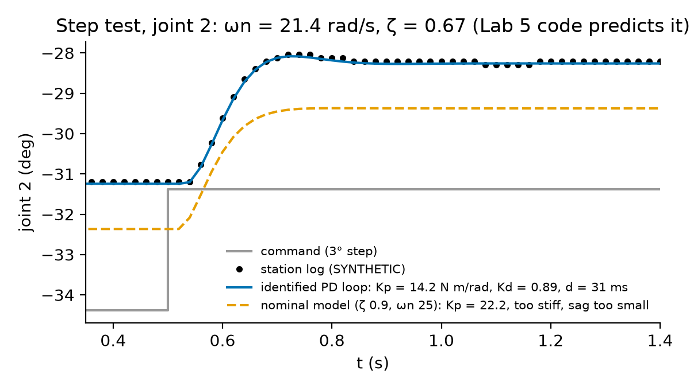
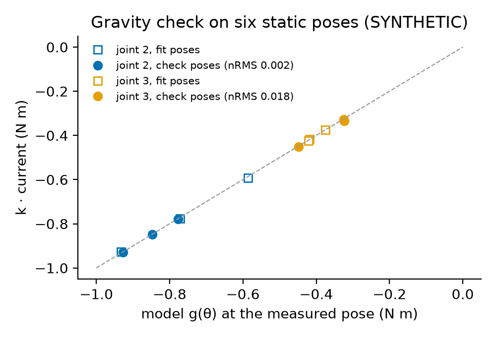
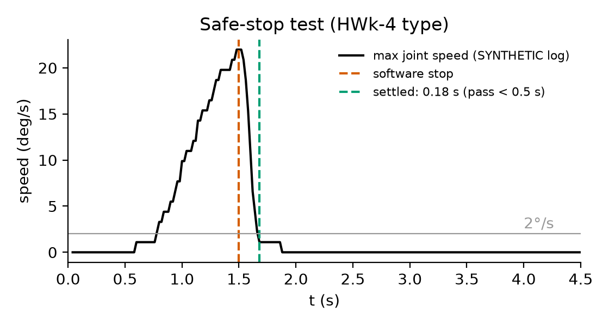

# Overview

| Item | Detail |
|---|---|
| Session | Session 4 (50 min): 12 min project safety induction (course arm and haptic device) for everyone, then a rotation between the arm stations (supervised) and the Tier 0 analysis bench. Finish the analysis at home (up to 2 h, due before the Week 9 lab). |
| CLOs | **461-6** (evaluate a PID joint controller on a real joint: step response, gravity, integral action, model error); **461-8** (build and run a system on hardware; first step of the project hardware run); 461-3 (apparent rotor inertia of a geared servo) |
| Files | `lab/starter.py` (you edit), `lab/test_lab.py` (auto-checks), `lab/course_arm.py` (the lab's own copy of the course-arm model, numbers identical to Course resources: *Course robot models and hardware safety checklist*), `lab/data/rotation1_task.json` (task), `lab/data/session_record_template.json`, five **synthetic** station logs for the simulation fallback (`step_log.csv`, `static_log.csv`, `hold_log.csv`, `move_log.csv`, `stop_log.csv`) |
| Reference | Your Lab 5 PID code (`pd_gains`, `pd_gravity_error`, `JointPID`, `simulate_joint`, given unchanged in `starter.py`); `modern_robotics` (`InverseDynamics`, `MassMatrix`); the project starter `sbeg461_project/hardware.py` (same log format and metrics) |
| Reading | Project brief §5.1–5.2; MR §11.4.1, pp. 423–429 (PD and PID of one joint, Eqs. 11.21–11.30) and §11.4.2, pp. 431–435 (decentralised control, PID + gravity compensation, Eq. 11.38); MR §8.9.2, pp. 311–313 (apparent inertia); Åström–Murray §6.3, pp. 183–185 (second-order step response, Table 6.1) |
| Assessment | Auto-checked (`test_lab.py`) + the signed induction sheet + the filled session record + a short results table and reflection. It counts as one auto-checked lab in the Labs component (Course syllabus §4 Assessment); it is not a formal report. **The signed induction is required before any project hardware session** (brief §5.2, rules A5 and B1). |
| AI use | Allowed with disclosure for the code (see Reflection). Not allowed for the induction quiz. |
| Tier | 0 (simulation, synthetic logs) for everyone; Tier 1 (course arm) as a supervised station run. Every part can be completed in Tier 0. |

**Where today's induction fits.** You completed the course-arm induction in SBEG 361. Today is the **full project
induction for both devices** (course arm and Hapkit-type haptic device); for the haptic device it is your first. It is
signed, and it is required before any project hardware session (rules A5 and B1 of brief §5.2) and before the Week 9
lab (Lab 8, impedance control on the haptic device). Today's run is practice: the hardware part of the project is
complete only after your team's **two supervised project sessions** in Weeks 10–13 (brief §5.3, project rubric).

**What you do today.** In Weeks 5–7 you designed PD, PID, computed-torque and LQR controllers for joints whose torque
you choose. The course arm is different: its smart servos are **position-controlled** (brief §5.1). Inside each servo a
firmware loop at 1 kHz is a PD controller of exactly the Lab 5 kind, acting on the joint after a bus delay of about
30 ms. You cannot change its gains, but you can **measure** them, and you can wrap your own loop around the servo:

$$M_{\text{eff}}\ddot q + b\dot q + g_j(q) = \tau,\qquad \tau = K_p\big(q_{\text{cmd}}(t - d) - q\big) - K_d\dot q\qquad\text{(MR Eq. 11.21, Eq. 11.23 with } K_i = 0)$$

1. a **step response** identifies the loop ($\omega_n$, $\zeta$, $d$), and static poses give its stiffness $K = K_p$;
   together they give $K_p$, $K_d$ and $M_{\text{eff}}$, and $M_{\text{eff}} - M_{jj}$ is the apparent rotor inertia (MR §8.9.2);
2. a PD loop **sags** under gravity by $g/K_p$ (MR Eq. 11.27). You remove the sag in two ways: **gravity feedforward**
   through the command, $q_{\text{cmd}} = q_d + \tilde g(q_d)/K$, which is PD + gravity compensation (MR Eq. 11.38) built
   from a position servo, and an **integral outer loop** at 50 Hz, the I of PID, written with your Lab 5 `JointPID`;
3. every run is **logged** and compared with a simulation of the same command (brief §5.4), and the software stop is timed.

Your functions go into your `sbeg461_dynamics` library as `hwrun.py`. You will use them again in the two project
hardware sessions (Weeks 10–13): project session 1 is bring-up, calibration and identification, which is exactly what
you rehearse today.

**Application context.**
*Biomedical:* the arm holds the 0.1 kg foam phantom of the patient-positioning mock-up at the tray pose. A positioning or
rehabilitation robot that sags 3° under load, or that creeps back slowly with integral action, is exactly what a
clinician notices first; the order of today's work (plan, check, dry-run, identify, compensate, compare) is the order of
commissioning such a device. *Defence (protective and humanitarian):* the same bring-up applies to an EOD manipulator
before it handles a suspect object, or to a casualty-handling arm before it touches a person: a supervised first motion
at reduced speed, an e-stop held by a named person, a keep-out zone, identified joint loops, and logging of every run and
fault. All robot and servo data are **illustrative values** (see Course resources: *Course robot models and hardware safety
checklist*), not the data of a product.

# Learning objectives

By the end of the session you can:

1. Apply the hardware safety checklist of project brief §5.2 (rules A1–A7 and B1–B6) and fill in a session record that passes `preflight`.
2. Dry-run a step command through the servo model and explain why a step **against** gravity needs more torque than a step with it.
3. Identify a servo's PD loop from a step response and static poses: $\omega_n$, $\zeta$, $d$, $K_p$, $K_d$, $M_{\text{eff}}$ and the apparent rotor inertia.
4. Predict a measured step with your Lab 5 PID code, and quantify the model error against the nominal model.
5. Remove the gravity sag of a position servo with gravity feedforward and with an integral outer loop, and compare speed, model dependence and safety of the two.
6. Log, compare and stop: sim-vs-hardware RMS errors, torque against current, and the safe-stop time.

# Pre-lab check (complete before the session; 5 questions)

1. A servo PD loop with $K_p = 15$ N m/rad holds a joint against a gravity torque of 0.84 N m. How far does the joint sag
   (rad and degrees)? What change of the **command** removes the sag?
2. The rated joint speed is 160°/s. What speed limit (rad/s) applies to a first run of a new motion, and what to a
   repeated motion (brief §5.2, rule A3)?
3. A step response overshoots by 9.5 % and peaks 0.20 s after the motion starts. Estimate $\zeta$ and $\omega_n$
   (Åström–Murray Table 6.1).
4. The same loop has $\omega_n = 20$ rad/s and a static stiffness $K = 15$ N m/rad. What inertia $M_{\text{eff}}$ does the loop
   move? The link inertia is $M_{jj} = 0.0155$ kg m²: what is the rest, and how large is the rotor inertia for a gear ratio $G = 200$?
5. Name four items of the safety checklist that must be true **before** the arm is powered.

*Answers (for self-check):* 1. $e = g/K_p = 0.84/15 = 0.056$ rad $= 3.21°$ (MR Eq. 11.27). Command $q_d + g/K_p$: the
servo then pushes with $K_p(q_{\text{cmd}} - q) = g$ while $q = q_d$. 2. $0.25\times160° = 40°/\text{s} = 0.698$ rad/s;
$0.5\times160° = 80°/\text{s} = 1.396$ rad/s. 3. $\zeta = -\ln0.095/\sqrt{\pi^2 + \ln^2 0.095} = 0.600$,
$\omega_n = \pi/(0.20\sqrt{1 - \zeta^2}) = 19.6$ rad/s. 4. $\omega_n^2 = K_p/M_{\text{eff}}$ (MR Eq. 11.26), so
$M_{\text{eff}} = 15/400 = 0.0375$ kg m²; the rest, $0.022$ kg m², is the apparent rotor inertia $G^2\mathcal I_{\text{rotor}}$
(MR §8.9.2), so $\mathcal I_{\text{rotor}} = 0.022/200^2 = 5.5\times10^{-7}$ kg m². 5. Any four of: signed induction for everyone
at the arm (A5); supervisor present and e-stop tested (A7); e-stop held by a named member (B4); keep-out zone taped and clear
(A2, A6); workspace ready, i.e. mat, payload fixed, cables tidy (B5); payload ≤ 0.125 kg (A4); every command ≥ 10° inside the
joint limits (A1); dry run with peak speed and torque inside the limits, written on the log (A3, B2); servo current limit
≤ 60 %; station-loop gains inside the approved range (B2).

# Setup

```bash
cd "<your Lab code folder>"          # or your Classroom 50 repo
python -c "import numpy, scipy, modern_robotics; print('ok')"
LAB_IMPL=starter python -m pytest -q test_lab.py   # expected: 18 failed, 1 passed (NotImplementedError)
```

On Windows (PowerShell) use `$env:LAB_IMPL="starter"; python -m pytest -q test_lab.py`. The provided parts of
`starter.py` are the model and task loaders (`course_arm_model`, `inverse_dynamics`, `gravity_torques`, `mass_diagonal`,
`load_task`), the log tools (`write_log`, `load_log`, `log_window`), the station commands (`step_command`, `smooth_move`),
`check_command`, `tracking_metrics`, `average_approaches`, `step_response`, `normalised_rms`, **your Lab 5 PID code**
(`plant_gravity`, `plant_rhs`, `rk4_step`, `pd_gains`, `pd_gravity_error`, `JointPID`, `simulate_joint`), and the servo
model of the arm: `joint_plant` (one arm joint as a Lab 5 plant), `nominal_servo`, `make_servo`, `ServoArm` (the
simulation fallback, with the same `read` / `send` / `wait` methods as the station's hardware object) and `ReplayIO` (plays
a log back through the same methods). You write the 16 functions marked TODO.

# The rotation (50 min)

| Time | Everyone | Arm stations (up to 4, one team each, TA present) |
|---|---|---|
| 0–12 | **Project safety induction** for both devices (briefing at a demonstration station, see below), induction quiz, signatures | Demonstration: e-stop test, keep-out zone, homing |
| 12–50 | Tier 0 bench: Parts A–D on the synthetic logs, in your team | Each team in turn, **about 10 min per team**: pre-flight (Part A), two static poses, the 3° step on joints 2 and 3, the hold test in four modes, the move and the software stop |

Teams that are not at a station work on Parts A–D. If your team gets no slot, the synthetic logs are your data (the
simulation fallback). Everyone takes the haptic-device part of the induction, because rule B1 names this Week 8
induction for the haptic device. Scenario 1 and 6 teams run the arm today like everyone else.

## Project safety induction (12 min, required, signed)

The induction covers the whole hardware safety checklist of project brief §5.2: rules **A1–A7** for the course arm (quoted
from the shared course-arm checklist in Course resources: *Course robot models and hardware safety checklist*) and the session
rules **B1–B6** for both devices. You sign this list. Every rule has a reason, and you must be able to state it.

| Rule (brief §5.2) | What you sign | Why |
|---|---|---|
| A5, B1 | Everyone who touches the course arm or the haptic device has completed and signed this induction | The rules only protect people who know them |
| A7, B1 | The e-stop (or stop button) is tested at the start; a TA or the instructor supervises the whole session; never run hardware alone | Someone who is not busy with the laptop watches the device |
| B2 | Dry run: the exact command file (and your station loop) runs in simulation first; the predicted peak speed and torque (or force, current) are written on the session log | A plan that is wrong in simulation is wrong on the arm. Writing the numbers down makes you compare them afterwards |
| A1 | Software joint limits at least 10° inside the hardware limits (≤ ±155°, J6 ≤ ±165°) | A wrong offset or overshoot stops in software before it reaches the end stop |
| A3 | Joint speed ≤ 25 % of rated (≤ 40 °/s) on the first run of any new motion; ≤ 50 % (≤ 80 °/s) otherwise | Reaction time for the e-stop holder, and margin for model error |
| A4 | Payload ≤ 50 % of the rated 0.25 kg, i.e. **≤ 0.125 kg**, unless the department approves an exception | Margin for the servo torques and for a payload error that the model does not know (Part C) |
| (A, current) | Servo current limit ≤ 60 % of rated, set **in the servo firmware** | The firmware limit acts even if your code is wrong |
| B4 | The e-stop (power cut-off) is within reach of a named member who holds it during every motion | The person at the laptop is looking at the screen, not at the arm |
| A2, A6 | Keep-out zone of reach + 0.3 m ≈ 0.58 m, taped; nobody inside while the arm can move; a hand may enter for a measurement only with the arm in latched stop and torque disabled (or power removed), with the safety officer's approval | A servo fault or a wrong offset can move a joint at full speed |
| B5 | Workspace: cables tidy, no loose clothing or hair, no faces at arm height, payload fixed, mock obstacles fixed, soft mat under the workspace | Smart servos **drop** the arm when power is cut |
| B3 | Haptic device: handle force saturated at 2 N in the firmware; watchdog sets the motor output to zero if the handle leaves ±40 mm or the loop overruns; only the operator's hand on the handle | Your own controller runs on this device, so the firmware must catch its errors |
| B6 | Logging: every run is logged (CSV); faults go on the session log with time, unit number and symptom; the supervisor initials it | Faults that are not written down cannot be fixed or excused (brief §5.5) |


**Stop immediately** (e-stop) on any unexpected motion, noise, contact, smell of overheating or a wrong first pose.
Do not restart until the TA has checked the arm. **E-stop vs software stop.** The e-stop cuts power: the arm drops
onto the mat, which is why the mat is required. The software stop freezes the command, so the servos hold the
current pose (Part D measures how fast). Use the e-stop whenever in doubt.

**Your station loop (this rotation only).** Part D runs **your** code in a 50 Hz loop around the servos. Its gains are
limited to the values approved for this rotation: integral gain $K_i \le 4$ s⁻¹ and a correction clamp of at most 5°
(PREFLIGHT rule "B2 (station loop)"). Week 5 (WE11) showed why: a loop around this servo (about 20 rad/s, 30 ms delay)
becomes unstable near 15 s⁻¹, and a safe outer loop is about five times slower than the servo. The clamp limits what a
wrong sign or a wrong offset can do before the e-stop holder reacts.

**Haptic device (rule B3, demonstrated on a device at the station).** The 2 N saturation and the ±40 mm / loop-overrun
watchdog are in the firmware, so they act whatever your controller does. Your own impedance controller runs on the device in
the Week 9 lab (Lab 8) and in the project (Scenarios 1 and 6).

**Induction quiz** (on paper, no AI, 3 questions, all must be correct; the TA marks it on the spot): (1) What do you do if
the arm moves towards an unexpected pose at the first command? (2) Why must the mat be under the workspace? (3) Who may
be inside the tape while the arm can move? *(Answers: e-stop, tell the TA, write the fault on the log; servos drop
the arm on power loss; nobody; a hand may enter for a measurement only with the arm in latched stop and torque disabled (or power removed),
with the safety officer's approval.)*

# Procedure

## Part A — Pre-flight: units, the dry run and the session record (10 min)

1. Implement `servo_to_model` and `model_to_servo`. The servos report degrees from their own zero:
   $q_{\text{model}} = q_{\text{servo}} - \text{offset}$, i.e. the model angle is the servo reading minus that unit's zero
   offset (both in degrees, then converted to radians), and `model_to_servo` adds the offset back. The station offsets
   are in the task file (illustrative, for unit 3; use **your unit's** values at the station).
2. Implement `dry_run`. Run the command table through `ServoArm(model, servo, joints, enc_res=0)`, with no torque limit,
   and return the peaks of $|\dot q|$ and of the servo torque over all firmware steps, divided by the derated limits
   (25 % of rated speed for a first run, 60 % of rated torque). Use the **nominal** servo before identification:
   `nominal_servo(model, q, task)` gives $K_p$, $K_d$ for $\zeta = 0.9$, $\omega_n = 25$ rad/s with the nominal
   armature of the task file (through Lab 5 `pd_gains`).
3. Dry-run the step test (`step_command(pose, [2, 3], [0.5, 2.0], 3.0, 3.5)`: 3° on joint 2 at 0.5 s and on joint 3
   at 2.0 s, from the tray pose), then the same step **upwards** (−3°).
4. Fill in `data/session_record_template.json` for your team (save it as `session_record.json`): the weighed payload
   (today 0.1 kg; rule A4 allows at most 0.125 kg), `limits_ok` from `check_command(...)["within_limits"]` of every command
   file, the dry-run fraction and the largest dry-run ratios, and the station-loop gains you will use in Part D. Implement
   `preflight` and run it on your record. It must return an empty list before the TA lets you power the arm.

**Checkpoint A.** First command in servo degrees: $(1.5, -36.38, 80.71, -137.51, -90.95, 0.0)$; compare it with the
station's display before the first motion. Nominal servo at the tray pose: $K_p = (22.16, 11.73)$ N m/rad and
$K_d = (1.596, 0.844)$ N m s/rad for joints 2 and 3. The **downward** 3° step: peak speed 0.518 rad/s on both joints
(speed ratio 0.742; the closed-form peak of a second-order step is $9.851A$ rad/s for $\zeta = 0.9$, $\omega_n = 25$), torque
ratios 0.538 and 0.458: allowed. The **upward** 3° step: torque ratios 1.082 and 1.077: **not allowed**. A step asks for a
torque spike $K_pA$ on top of the gravity torque; downwards the spike and gravity have opposite signs, upwards they add
($0.80 + 22.16\times0.0524 = 1.96$ N m > 1.8 N m on joint 2). The step test therefore goes **with** gravity.
`pytest -q -k "conversion or dry_run or preflight or limit"` passes.

## Part B — Step response of the servo's PD loop (10 min)

At the station the TA runs the 3° step of Part A on joint 2 and then on joint 3, from the tray pose. Use
`data/step_log.csv` (synthetic) or your own log. The windows of the two steps are in `task["step_test"]["windows_s"]`
(`log_window` cuts them).

5. Implement `zeta_wn_from_step` (Åström–Murray Table 6.1, p. 185; MR p. 415) and `step_features` (step time, overshoot,
   peak time, a rough start of motion).
6. Implement `identify_servo`: least squares on $y(t) = y_0 + A\,h(t - t_{\text{step}} - d;\ \omega_n, \zeta)$, where $h$ is the unit step
   response (`step_response`). Solve $y_0$ and $A$ linearly inside the residual and fit $(\omega_n, \zeta, d)$ with
   `scipy.optimize.least_squares`. Start from the hand estimate.

**Checkpoint B.** Overshoot 5.9 % (joint 2) and 6.3 % (joint 3). The fit gives $\omega_n = 21.36$ rad/s, $\zeta = 0.669$,
$d = 31.1$ ms (joint 2) and $20.90$, $0.658$, $28.3$ ms (joint 3), with a residual RMS below $6\times10^{-4}$ rad. The hand
estimate from the 50 Hz log is rough ($\omega_n \approx 25$–28 rad/s): the peak time and the start of motion are known only to
±20 ms. Say in one sentence why the least-squares fit is better. The servo is less damped and slower than the nominal model
($\zeta = 0.9$, $\omega_n = 25$).

## Part C — Static poses and the servo's PD gains (12 min)

At the station the TA moves the arm to two of the six static poses of the task file. Each pose is approached from below
and from above, and the station software records the settled position and current. The synthetic `static_log.csv` has
all six poses.

7. Implement `torque_constant` and `loop_stiffness` (same definitions as the project's `hardware.py`).
8. Implement `gravity_check`. Average the two approaches (`average_approaches`, which cancels static friction to first
   order). Compute $g(\theta)$ at the **measured** pose with the RNEA. Fit $k_j$ on poses 1, 3, 5 and check it on poses 2,
   4, 6 with `normalised_rms`. Fit the loop stiffness $K_j$ from the sag $q_{\text{cmd}} - q_{\text{meas}} \approx g_j/K_j$. For a PD
   servo at rest $K_p(q_{\text{cmd}} - q) = g(q)$ (MR Eq. 11.27), so **$K = K_p$**.
9. Implement `servo_from_fit` (Lab 5 `pd_gains` backwards): $K_p = K$, $M_{\text{eff}} = K/\omega_n^2$,
   $K_d = 2\zeta\omega_nM_{\text{eff}} - b$ (MR Eq. 11.26, take $b = 0$: the fit sees only $b + K_d$), and the apparent rotor
   inertia $M_{\text{eff}} - M_{jj}$ with $M_{jj}$ from `mass_diagonal` (MR §8.9.2).
10. Implement `predict_step` with the **Lab 5 code**: a 1 ms grid, the command delayed by $d$ and held (zero-order hold), the
    start on the sag (`pd_gravity_error`), and `simulate_joint` with `JointPID(kp, 0, kd, h)` on the plant
    `joint_plant(model, q_lock, j, M_eff)`. Lock the other joints at their **measured** angles at the start of the window
    (they sag too). Predict both steps with your identified loop and with the nominal one, and compare with the log.

**Checkpoint C.** Joints 2–4: $k = (1.182, 1.175, 0.444)$ N m/A, nRMS on the check poses $(0.002, 0.018, 0.023)$, far below the
project threshold of 0.3. Loop stiffness $K = (14.21, 7.46, 1.98)$ N m/rad. Joint 2: $K_p = 14.21$ N m/rad,
$M_{\text{eff}} = 0.0312$ kg m², $K_d = 0.890$ N m s/rad, apparent rotor inertia $0.0312 - 0.0155 = 0.016$ kg m², about the link
inertia again; joint 3: $7.46$, $0.0171$, $0.470$ and $0.010$ kg m². The sag at the tray pose is $0.796/14.21 = 0.056$ rad
$= 3.2°$ (joint 2) and $2.8°$ (joint 3). Predicted steps: RMS(prediction − log) $= 0.0008$ and $0.0006$ rad with the identified
loop (less than one encoder count, 0.0015 rad), $0.020$ and $0.014$ rad with the nominal one. **Pitfalls:** $k$ and $K$ absorb any
error proportional to $g$: the synthetic unit carries 20 g more than the model (clip and cable), so both come out about 5 % low
and the checks still pass. And $M_{\text{eff}}$ of a joint inside a moving arm is not exactly the decoupled value of MR
§11.4.2.1: the other joints' servos also move (the synthetic truth is fully coupled).





## Part D — Gravity compensation, logging and the safe stop (15 min)

11. Implement `gravity_comp_command`: $q_{\text{cmd},j} = q_{d,j} + g_j(q_d)/K_j$ for joints 2 and 3. With the servo's
    $\tau = K_p(q_{\text{cmd}} - q) - K_d\dot q$ this is $\tau = K_p(q_d - q) - K_d\dot q + \tilde g(q_d)$: PD control plus gravity
    compensation (MR Eq. 11.38 with $K_i = 0$), built from a position servo.
12. Implement `station_hold`, the 50 Hz station loop of the hold test: at every sample read the encoders, build the command,
    send it, wait. Mode `"none"` sends $q_d$. From $t_{\text{on}} = 0.5$ s, mode `"ff"` adds the gravity offset, ramped in over
    0.5 s (bumpless switch-on); mode `"int"` adds, per joint, the output of a Lab 5 `JointPID(0, ki, 0, dt, tau_max=clamp)`:
    an integral of the error $q_d - q$, clamped at 5°, with the Lab 5 anti-windup; mode `"ff+int"` starts the integral only
    when the feedforward is fully on, so that it does not also integrate the sag that the feedforward is removing.
    Check it first on `ServoArm` (your simulation fallback), then on `ReplayIO(log)`: fed the logged measurements, your loop
    must send exactly the logged commands.
13. Implement `compare_runs` (project brief §5.4: commanded-vs-measured and simulated-vs-measured RMS and maximum errors, and
    the lag). Compare the hold log and the move log (`move_log.csv`: the station move routine takes joints 2 and 3 from the
    tray pose to $(-1.0, 1.7)$ rad and back in 6 s) with two simulations of the **same command**: `ServoArm` with the
    nominal servo and with your identified one (`make_servo(nominal, fits)`). Optional: the normalised RMS of the predicted
    servo torque against $k_j\times$ current during the move.
14. Implement `stop_time`. Measure the time from the software stop (`stop_log.csv`, trigger at 1.5 s, during the move)
    until every joint is slower than 2°/s.

**Checkpoint D.** Gravity offsets at the tray pose: $-3.21°$ (joint 2) and $-2.76°$ (joint 3). Hold test, mean of
desired − measured over the last 0.5 s:

| Mode | Joint 2 | Joint 3 | Within 0.25° after switch-on |
|---|---|---|---|
| none (PD sag) | −3.18° | −2.49° | never |
| ff (gravity feedforward) | −0.01° | −0.03° | 0.58 s (the 0.5 s ramp + the loop) |
| int ($K_i = 3$ s⁻¹) | 0.005° | 0.000° | 0.72 s |
| ff + int | 0.005° | 0.000° | 0.58 s |

The feedforward is as accurate as your model and your $K$ at this pose (here within one encoder count, 0.088°), and as fast
as the servo; the integral needs no model but takes $\approx 1/K_i$ to act and must be clamped. ReplayIO reproduces the logged
commands to $10^{-6}$ rad, and the identified simulation of each hold run is within 0.001 rad RMS of the log.

| Move log, joints 2 and 3 (rad) | J2 | J3 |
|---|---|---|
| RMS(cmd − meas) | 0.0551 | 0.0486 |
| RMS(nominal sim − meas) | 0.0182 | 0.0156 |
| RMS(identified sim − meas) | 0.0008 | 0.0010 |

The lag is $0.10$ s $\approx 2\zeta/\omega_n + d + \Delta t/2 = 0.063 + 0.031 + 0.010$ s. The nominal model is wrong mainly because
it is too stiff: it predicts too little sag (about 1° less on joint 2). Torque nRMS during the move: $0.022$ (J2), $0.034$
(J3). Stop time $0.18$ s, below the 0.5 s of the project tests. `pytest -q` passes completely (19 tests).




# At the station (team procedure, about 10 min)

1. Show the TA your `session_record.json` with `preflight(...) == []`, and the dry-run numbers written on the
   printed session log. Members who touch the arm show their signed induction.
2. The TA powers the arm and tests the e-stop. The named holder takes the e-stop. Everyone else stays outside the tape.
3. Homing: the station routine moves the arm slowly to the tray pose. Check the pose against your servo-degree values
   from Part A **before** the first motion.
4. The TA runs two static poses and the downward 3° steps. Your station loop then runs the hold test in the four modes
   (3 s each) with $K_i \le 4$ s⁻¹ and a 5° clamp, then the move and the software stop. The logger writes
   `t, cmd_1..6, meas_1..6, cur_1..6` (and `mode` for the hold test).
5. Copy the logs, write any fault on the session log, and have the TA initial it.

If the arm fails or the slot is lost, the fault is recorded and your team uses the synthetic logs. This is the
simulation fallback, and it carries no penalty in this lab.

<!-- library-block:begin -->
# Your `sbeg461_dynamics` library

When the tests pass, copy the functions you wrote in Hardware rotation 1 into your cumulative library as `hwrun.py`. The functions you write (16):

`servo_to_model(q_servo_deg, offset_deg)`, `model_to_servo(q_model, offset_deg)`, `dry_run(model: dict, t, cmd, servo: dict, joints=(1, 2), speed_fraction: float=0.25, torque_fraction: float=0.6)`, `preflight(record: dict)`, `zeta_wn_from_step(overshoot: float, t_peak: float)`, `step_features(t, cmd, meas, threshold: float=0.1)`, `identify_servo(t, cmd, meas, window: float=1.0)`, `torque_constant(current, tau_model)`, `loop_stiffness(sag, tau_model)`, `gravity_check(static: dict, model: dict, joints=(1, 2, 3), fit=(0, 2, 4), check=(1, 3, 5))`, `servo_from_fit(wn: float, zeta: float, K: float, b: float=0.0, M_link: float | None=None)`, `predict_step(plant: dict, kp: float, kd: float, t, cmd, delay: float, h: float=H, enc_res: float | None=None)`, `gravity_comp_command(model: dict, q_des, K, joints=(1, 2))`, `station_hold(io, q_des, n: int, mode: str, model: dict | None=None, K=None, ki: float=3.0, clamp: float=np.deg2rad(5.0), t_on: float=0.5, t_ramp: float=0.5, joints=(1, 2), dt: float=DT)`, `compare_runs(t, cmd, meas, sim, skip: float=0.0)`, `stop_time(t, q, t_trigger: float, threshold: float=np.deg2rad(2.0), window: float=0.1)`.

Names shared with other labs:

* The provided `pd_gains`, `pd_gravity_error`, `JointPID`, `simulate_joint`, `plant_rhs` and `rk4_step` are your Lab 5 functions, unchanged (same signatures); `JointPID` is the controller of Lab 5 and of the station loop of Part D.
* The provided `check_command` is the same function as in Lab 9 (Week 10). The provided `tracking_metrics(t, cmd, meas, max_lag)` belongs to this rotation: it is not Lab 6's `run_metrics` and not the project's `metrics.tracking_metrics(sim, ref, skip)`, which has a different signature.

The provided helpers at the top of `starter.py` (loaders, servo model, simulators) do not have to go into the library. The full list of library functions of all labs is in the Week 13 lab handout.
<!-- library-block:end -->

# Deliverables (upload to the course site before the Week 9 lab)

1. `starter.py` passing `LAB_IMPL=starter python -m pytest -q test_lab.py` (all tests).
2. Your `session_record.json` (passes `preflight`) and a photo or scan of the signed induction sheet and the initialled
   session log.
3. A results table with the values of Checkpoints A–D for **your** data (station log, or synthetic if you had no slot).
   Label every number "measured" or "synthetic".
4. Two figures: the step prediction of joint 2 (Part C) and the hold test of joint 2 in the four modes (Part D). Use labelled
   axes and units, and put "measured" or "synthetic" in the title.
5. Reflection (≤ 1 page, below).

# Reflection (≤ 1 page)

1. Which result of today would you trust on the real arm, and which not? Name two sources of model error and give a
   number for each (for example the sag, the lag, the payload error hidden in $k$ and $K$, the coupling between joints).
2. Gravity feedforward or integral action? Compare them on today's data for a patient-positioning robot that must hold a
   pose while the load changes (a patient's limb is placed on it). Which would you use, and why both together?
3. The project hardware tests allow an RMS difference between simulation and measurement of about 1–1.5° per joint
   (HW2-2, HW3-2). Would the nominal servo model meet it on today's data? What must your project simulation contain?
4. Which rule of the safety checklist (A1–A7, B1–B6) would you have skipped if no one had checked it? Why is it there?
   Ethics prompt (short): in a real patient-positioning or casualty-handling robot, who should hold the e-stop, and who
   decides that a fault is "fixed"?
5. **AI-use note** (required, Course syllabus §8 AI-use policy): name the tool(s), the prompts or questions, and what you kept or rejected. You must
   be able to explain every line of `identify_servo`, `predict_step` and `station_hold` in the oral check.

# Troubleshooting

| Symptom | Likely cause and fix |
|---|---|
| Dry run of the step fails on torque | The step goes **up** against gravity: $K_pA$ and $g$ add. Step downwards, or use 2°. |
| Dry-run peak speed far below the closed form | You used the logged (50 Hz) samples instead of the firmware-step peaks of `ServoArm.run`. |
| `identify_servo` returns $\zeta$ at a bound or a delay of 0 | Window too short, or both steps in one window. Use the windows in the task file and check that `cmd` has exactly one step. |
| Fitted $\omega_n$ far from the hand estimate | Expected with 50 Hz data (see Checkpoint B). Plot the fit over the samples; trust the fit if it passes through them. |
| $k$ or $K$ negative, or nRMS ≈ 1 | Current column of the wrong joint, or $g$ evaluated at the commanded instead of the measured pose with a sign error. Plot $k\,i$ against $g$. |
| `predict_step` misses joint 3 by about 0.3° throughout | The other joints are locked at the **commanded** angles; joint 2 sags 3°, which changes joint 3's gravity torque. Lock them at the measured angles. |
| `predict_step` rises too early | The delay is missing, or applied with the wrong sign: the command acts from $t_k + d$. |
| Hold test: `ff` moves the joint the wrong way | Sign of the offset: the joint settles where $K_p(q_{\text{cmd}} - q) = g(q)$, so $q_{\text{cmd}} = q_d + g/K$. |
| Hold test: `ff+int` overshoots | The integral started before the feedforward was fully on and integrated the sag as well. |
| Replay does not reproduce the logged `cmd` | A new `JointPID` every sample (the integral restarts), or the integral not limited by the clamp. |
| `stop_time` returns `inf` | The log ends before the arm settles, or the speed estimate is noisy: use the 0.1 s window. |
| `ModuleNotFoundError: course_arm` | Run pytest from inside `lab/`. |

# C++ track

You may do the code of this lab in C++17 instead of Python. The functions, data files, checkpoints, station procedure
and deliverables are the same (deliverable 1 is `cpp/starter.cpp` with all 18 C++ test cases passing, instead of
`starter.py`); the auto-checks compare your results with `mrcpp` (the C++ port of `modern_robotics` in the course
folder `cpp_support`: `inverse_dynamics`, `mass_matrix`), with the closed forms and synthetic signals of the Python tests,
with the synthetic station logs in `data/` and with the numbers of the Python reference, so both tracks are marked against
identical values. The session record is the same JSON file (`session_record.json`), and your C++ `preflight` reads it with
`sbeg::load_json`.

**Files** (in the `cpp` sub-folder of your Lab code folder): `starter.cpp` (your work), `lab.hpp` (declarations and
documentation — do not change), `test_lab.cpp` (auto-checks, doctest), `cpp_cases.json` (reference numbers),
`CMakeLists.txt`, and given code you do not edit: `course_arm.cpp` (C++ copy of `course_arm.py`, same numbers) and
`helpers.cpp` (the provided part of `starter.py`, including the Lab 5 PID code, `ServoArm` and `ReplayIO`). The data files are
the same files in `data/`. `cpp_support` (Course resources) must sit next to your lab folders or in a parent folder of them
(the build finds it automatically up to 6 levels up).

**Requirements.** A C++17 compiler — Windows: Visual Studio Build Tools (2022 or 2026), workload "Desktop development with
C++"; macOS: `xcode-select --install`; Ubuntu: `sudo apt install build-essential`. CMake and Ninja come with
`pip install cmake ninja` (both are in the course `requirements.txt`).

**Build and run** (from your Lab code folder):

```bash
python run_lab.py hw1 --cpp                    # configure, build, run, print Score: k/n
# or directly:
cmake -S cpp -B build -G Ninja
cmake --build build
./build/lab_tests                              # Windows: build\lab_tests.exe
./build/lab_tests -tc="*dry_run*,*preflight*"  # only some tests (like pytest -k)
```

With the untouched starter, the program builds and all 18 test cases fail with `TODO: <function>`: this is
expected. Rebuild (`cmake --build build`) after every change.

**Functions to write** (in `starter.cpp`, the same 16 functions and order as in Python): `servo_to_model`,
`model_to_servo`, `dry_run`, `preflight` (Part A); `zeta_wn_from_step`, `step_features`, `identify_servo` (Part B);
`torque_constant`, `loop_stiffness`, `gravity_check`, `servo_from_fit`, `predict_step` (Part C); `gravity_comp_command`,
`station_hold`, `compare_runs`, `stop_time` (Part D). Given and complete, as in `starter.py`: `course_arm_model`,
`inverse_dynamics`, `gravity_torques`, `gravity_torques_rows`, `mass_diagonal`, `load_task`, `data_path`, `write_log`,
`load_log`, `log_window`, `step_command`, `smooth_move`, `check_command`, `tracking_metrics`, `average_approaches`,
`step_response`, `normalised_rms`, the Lab 5 code (`plant_gravity`, `plant_rhs`, `rk4_step`, `pd_gains`, `pd_gravity_error`,
`JointPID`, `simulate_joint`), `joint_plant`, `nominal_servo`, `make_servo`, the classes `ServoArm` and `ReplayIO` (both
derive from the station interface `ServoIO`), plus two replacements for NumPy/SciPy: `median` (= `np.median`) and
`least_squares` (a bounded Levenberg–Marquardt solver that replaces `scipy.optimize.least_squares` in `identify_servo`).
The constants `DT`, `H`, `ENC_RES`, `MODES`, `PAYLOAD_MAX_KG`, `OUTER_KI_MAX`, `OUTER_CLAMP_MAX_DEG` and `PREFLIGHT_RULES` are
in `lab.hpp`.

**Checkpoints** (18 C++ test cases with the Python test names; the Python track counts 19 tests: its test of the provided
`check_command` — the 10° joint-limit margin of rule A1 — passes from the start in Python and is checked inside
`test_preflight` in C++).
A: `./build/lab_tests -tc="*conversion*,*dry_run*,*preflight*"` (3 test cases);
B: `-tc="*zeta*,*step_features*,*identify_servo*"` (4); C: `-tc="*torque_constant*,*loop_stiffness*,*gravity_check*,*servo_from_fit*,*predict_step*"`
(5); D: `-tc="*gravity_comp*,*station_hold*,*compare_runs*,*move_log*,*stop_time*"` (6); finally
`./build/lab_tests` must show 18 passed.

**Differences from the Python version.**

| Python | C++ |
|---|---|
| a `dict` result (`d["ok"]`, `r["wn"]`, `s["kp"]`) | a small struct with the same field names, declared in `lab.hpp`: `DryRun`, `StepFeatures`, `ServoFit`, `GravityCheck`, `ServoPD`, `HoldRun`, `RunComparison` (`d.ok`, `r.wn`, `s.kp`) |
| `model` dict (`model["Mlist"]`, `model["tau_max"]`) | `lab::Model` with the same field names (`model.Mlist`, `model.tau_max`); `limits` is $6\times2$ |
| the servo dict (`kp`, `kd`, `M_eff`, `b`, `delay`) | `lab::Servo` with the same fields; `fits` of `make_servo` is a `std::map<int, lab::JointServo>` |
| the Lab 5 plant dict | `lab::Plant` (`M`, `b`, `g_cos`, `g_sin`, `tau_max` as `std::optional<double>`) |
| `io` with `read`, `send`, `wait` (duck typing) | `lab::ServoIO&` (an abstract struct); `ServoArm` and `ReplayIO` derive from it; `read()` returns `std::pair<VectorXd, VectorXd>` (an empty second vector when there is no current) |
| `servo_from_fit(...)["armature"] is None` | `std::optional<double> armature` (`s.armature.has_value()`) |
| logs, commands as `(N, n)` arrays | `Eigen::MatrixXd` with one row per sample; `t` is an `Eigen::VectorXd` |
| `load_log(path)` dict with `t`, `cmd`, `meas`, `cur` (or `None`), extra columns | struct `lab::Log`; an absent group is an empty ($0\times0$) matrix; extra columns in `log.extra` (`log.extra.at("mode")`); `log_window(log, t0, t1, mode)` |
| `scipy.optimize.least_squares(fun, x0, bounds=(lb, ub), x_scale=...)` | given `lab::least_squares(fun, x0, lb, ub, x_scale)` with `fun` a lambda returning the residual `Eigen::VectorXd`; the result has `x` and `cost` |
| `np.linalg.lstsq(X, y)` ($m\times2$); `np.interp`; `np.searchsorted` | `X.colPivHouseholderQr().solve(y)`; a short loop with `std::upper_bound` |
| `joints=(1, 2)`, `fit=(0, 2, 4)` (0-based) | `std::vector<int>{1, 2}`; copy the selected entries in a loop |
| `np.inf`, `np.nan` | `std::numeric_limits<double>::infinity()`, `quiet_NaN()` (`<limits>`) |
| `preflight(record: dict)`; `json.load` | `preflight(const sbeg::json& record)`; `sbeg::load_json(path)`; `record.contains("key")`, `.is_null()`, `.is_boolean()`, `.get<double>()` |
| figures with matplotlib | write CSV files (`lab::write_log` or `sbeg::write_csv`) and plot them in Python (see below) |

A matrix-size mistake (e.g. subtracting a row from a matrix without `.rowwise()`) does not crash the test program:
it is reported as a failed test with the message "Eigen: wrong matrix size or index out of range".

**Figures for the deliverables.** The plots stay outside the auto-checks. Write a small program that saves the step
prediction and the hold runs as CSV files (`lab::write_log(path, t, cmd, meas)` writes the station log format,
`sbeg::write_csv(path, header, matrix)` any table), and plot them with Python/matplotlib or another tool. To build
such a program, add these lines at the end of `cpp/CMakeLists.txt` (below `sbeg_lab(...)`) and write
`cpp/experiments.cpp` with a `main()`:

```cmake
add_executable(experiments experiments.cpp starter.cpp course_arm.cpp helpers.cpp)
target_link_libraries(experiments PRIVATE sbeg_mrcpp)
target_compile_definitions(experiments PRIVATE "SBEG_LAB_DIR=\"${CMAKE_CURRENT_SOURCE_DIR}\"")
```

**C++ troubleshooting.**

| Symptom | Likely cause | Fix |
|---|---|---|
| `cpp_support not found` | the course folder `cpp_support` is not next to / above your Lab code folder | copy it there, or configure with `-DSBEG_CPP_SUPPORT=<path>` |
| `No CMAKE_CXX_COMPILER could be found` | no C++ compiler installed | install it (see Requirements); on Windows run from the "x64 Native Tools Command Prompt" if Ninja cannot find `cl` |
| `cannot open file: .../cpp_cases.json` or `.../data/...` | Lab code folder moved after configuring | delete the `build` folder and configure again |
| `station_hold` replay test fails only after the switch-on | one `JointPID` per joint created inside the loop, or `tk >= t_on` compared without the `1e-9` tolerance | create the controllers before the loop; compare `tk >= t_on - 1e-9` |
| `predict_step` test stops at `REQUIRE(p.size() == ...)` | the result is on the fine grid | interpolate back onto `t` (one value per log sample) |
| `identify_servo` far off or at a bound | residual of the wrong length, window not applied, or `x_scale` forgotten | the residual has one entry per sample of the window; pass `x_scale = (10, 0.1, 0.01)` |
| `preflight` test: a rule fails on the good record | a number read with `get<int>()`, or `first_run` missing treated as a repeat run | read numbers with `get<double>()`; only `"first_run": false` means a repeat run |
| Results wrong only in some entries, no compile error | an Eigen product stored in `auto` (`auto C = A * B;` keeps references to temporaries) | write the type: `Eigen::MatrixXd C = A * B;` |
| Tests still show your old result | program not rebuilt | `cmake --build build` before `./build/lab_tests` |
