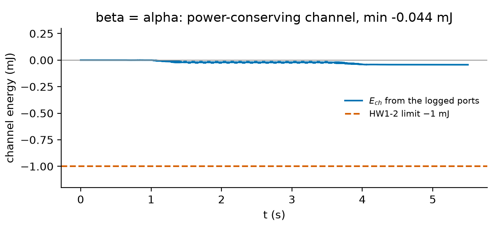
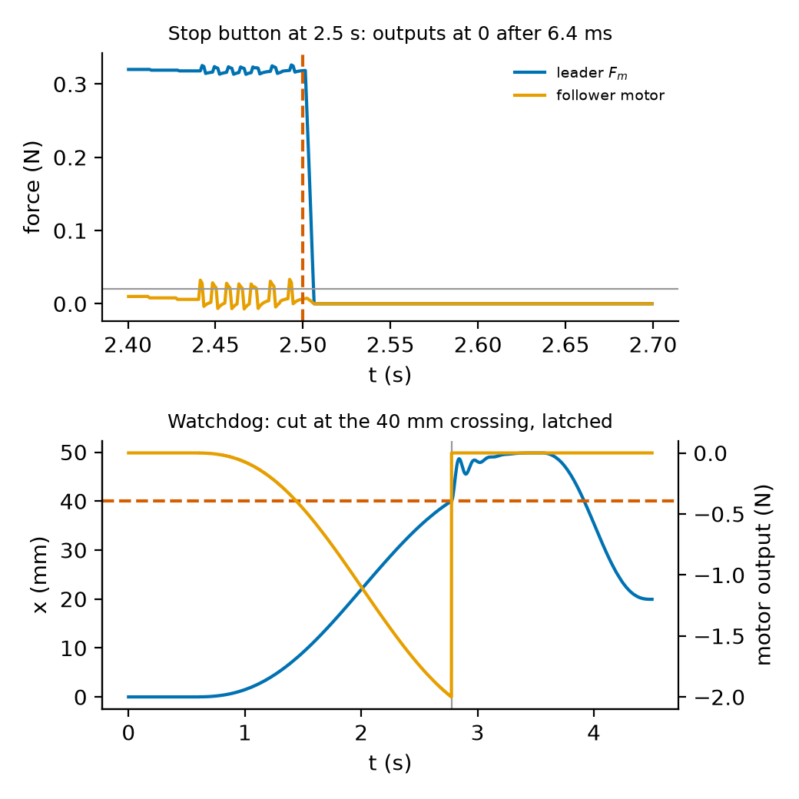
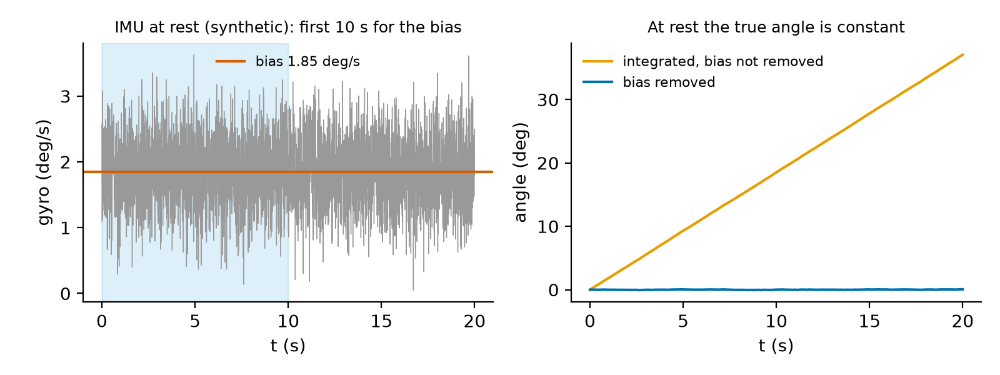

# Overview

| Item | Detail |
|---|---|
| Session | Session 4 (50 min): 12 min project safety induction for everyone (course arm, Hapkit pair, IMU module), then a rotation between the haptic stations (supervised trial, about 10 min per team) and the analysis bench. Finish the analysis at home (about 2 h, due before the Week 9 lab). |
| CLOs | **46X-9** (prepared by a supervised practice trial: induction, bring-up, identification, sim-vs-hardware; not part of the project hardware run); 46X-2 (P–P teleoperation, transparency and channel energy on real devices); 46X-3 (the sampled spring in the free decay; force limits) |
| Files (your Lab code folder) | `starter.py` (you edit; it becomes `sbeg46x_medrob/hwrun.py`), `test_lab.py` (auto-checks), `course_models.py` (the lab's own copy of the Hapkit model, the IMU data and the course-arm checklist values; numbers identical to Course resources: *Course robot models and hardware safety checklist*), `data/hw1_task.json` (station settings), `data/session_record_template.json`, `data/expected.json` (the checkpoint values of the synthetic logs) and six **synthetic** station logs for the simulation fallback: `decay_H07.csv`, `decay_H08.csv`, `trial_log.csv`, `stop_log.csv`, `watchdog_log.csv`, `imu_rest.csv` |
| Reference | Your Lab 2 and Lab 3 code (P–P architecture, channel energy); the project starter package (`hardware.py`, `hwtasks.py`: same log format and the same identification method) |
| Reading | Week 8 pre-class sheet: project brief §5.1–5.2; MR §11.7 pp. 443–446 and §11.8 pp. 447–448; Åström–Murray §6.3 pp. 183–185 (Table 6.1) |
| Assessment | Auto-checked code (`test_lab.py`; 35 of the 39 tests count, see Setup) + the signed induction sheet + your filled session record + a short results table and reflection. It counts as one auto-checked lab in the Labs component (Course syllabus §4). It is not a formal report. **The signed induction is required before any project hardware session** (brief §5.2, rules A5 and B1). |
| AI use | Allowed with disclosure for the code (see Reflection). **Not** allowed for the induction quiz. |
| Tier | Tier 1 (Hapkit pair and IMU module at a haptic station, TA present) for the trial; Tier 0 (synthetic logs) for everyone. Every part can be completed in Tier 0, with no penalty. |

**Where today fits.** You completed the course-arm and haptic-device inductions in SBEG 461, and a refresher in the first 10 minutes of Lab
2. Today is the **full project safety induction** for the course arm, the Hapkit pair and the IMU module. It is signed and required before
any project hardware session (Weeks 10–13). Today's trial is practice: your team's hardware run is two supervised project sessions in
Weeks 10–13 (brief §5.3). Session 1 of the project is "bring-up, identification of your unit, a dry-run-checked first run at reduced
limits, a first sim-vs-hardware overlay" (scenario sheets): exactly what you rehearse today.

**Application context.** *Biomedical:* the trial is a tissue-contact task on a Hapkit pair, the preparation for Scenario 1 (haptic
needle insertion) and for every teleoperated scenario. *Defence (protective, medical):* the same bring-up order (plan, dry run, slow first
run, compare with the model, log every fault, a named stop holder) applies to an EOD manipulator before it approaches a suspect object
and to a casualty-handling arm before it touches a person. All device numbers are **illustrative values**.

# Learning objectives

By the end of the session you can:

1. State the hardware safety checklist (rules A1–A7, B1–B7 and the current limit) with the reason for each rule, and fill in a session record
   that passes `preflight`.
2. Predict a teleoperation trial before running it: the dry run (peak forces and positions) and the static contact equilibrium.
3. Identify the mass and damping of your own Hapkit unit from a free decay, including the $KT/2$ correction of the sampled spring.
4. Check that the firmware safety layers act: the latched watchdog and the stop-button fade.
5. Analyse a logged trial: tracking, contact force against prediction, felt stiffness, channel energy and limits.
6. Compare the follower measurement with a replay simulation, and name the main model error.
7. Measure the bias and noise of an IMU module at rest and explain why every IMU session starts with it.

# Pre-lab check (complete before the session; 5 questions)

1. Name the two firmware limits of a Hapkit-type device and what each does. May you lower the loop rate to emulate a delay?
2. In a free-decay test the firmware renders $K = 100$ N/m at 1 kHz. Why does the decay show less damping than the handle has, and by how much?
3. With $K_p = 200$ N/m, $\alpha = \beta = 0.5$, a tissue wall $k_e = 300$ N/m at $x_w = 5$ mm and $k_g = 1.211$ N/m, which force does the
   leader show when you hold it at $x_m = 20$ mm?
4. Who may hold the stop button during a teleoperation trial, and who may touch the handles?
5. A gyro bias of 1.8°/s is not removed. What angle error do you get after 30 s at rest?

*Answers (for self-check):* 1. Force saturated at 2 N; watchdog that sets the motor output to zero (latched) if the handle leaves ±40 mm or a
loop overruns. No: delay is emulated in software on the station PC; the loop rate and the limits are never changed for it (B4). 2. The held
spring acts like a spring plus a negative damper $KT/2 = 0.05$ N s/m; add it back to the fitted damping. 3. $x_s = (200\cdot0.5\cdot0.020 +
300\cdot0.005)/501.21 = 6.983$ mm, $F_c = 200(0.010 - 0.006983) = 0.603$ N, $F_m = 0.302$ N. 4. The stop holder is a named team member who is
**not** the leader operator; only the operator's hand is on the leader handle and nobody's hand is on the follower (B3, B4); everyone who
touches a device has signed the induction (A5, B1). 5. $1.8\times30 = 54°$.

# Setup

```bash
cd "<your Lab code folder>"          # or your Classroom 50 repository
python -c "import numpy, scipy; print('ok')"
LAB_IMPL=starter python -m pytest -q test_lab.py   # expected now: 38 failed, 1 passed (NotImplementedError)
```

On Windows (PowerShell) use `$env:LAB_IMPL="starter"; python -m pytest -q test_lab.py`. The provided parts of `starter.py` are the loaders
(`load_task`, `load_record`, `load_log`, `write_log`), the operator intent (`minjerk`, `intent`), the tissue wall, the `Device` model (same
structure as the project starter's Hapkit, plus an optional Coulomb friction), `VelocityEstimator`, and three simulators: `simulate_pp`
(the trial: P–P without delay, the hand on the leader, the tissue in the follower firmware, an optional stop-button press),
`simulate_follower` (the follower replay of project test HW1-2) and `simulate_free_decay`. You write the 12 functions marked TODO A1 … D2.

**What the auto-checked mark counts.** Three of the TODOs, `fit_free_decay` (B2), `resample` (C1) and `channel_energy` (C2), are already
fully implemented in the project starter you have (`hwtasks.fit_free_decay`, `hardware.resample`, `hardware.channel_energy`). Port them
(the lab versions take an explicit fit window `t_end` and positions instead of velocities for the energy), but their four tests
(`test_fit_free_decay_on_the_nominal_device`, `test_fit_free_decay_station_units`, `test_resample`, `test_channel_energy_sign_and_value`)
are **not counted** in the auto-checked mark. The Lab HR1 mark counts the remaining **35 tests**: `test_course_models_match_task`, the
preflight tests, `contact_equilibrium`, `dry_run`, `log_decrement`, `watchdog_check`, `trial_metrics`, `sim_vs_hw`, `fade_time` and
`imu_rest_stats`. `trial_metrics` and `sim_vs_hw` call `resample` and `channel_energy`, so those must still work.

# The rotation (50 min)

| Time | Everyone | Haptic stations (up to 4, one team each, TA present) |
|---|---|---|
| 0–12 | **Project safety induction** (below), induction quiz, signatures | TA demonstration: watchdog trip, 2 N saturation, stop button; the arm demonstration station (e-stop test, keep-out tape, homing) |
| 12–50 | Analysis bench: Parts A–D on the synthetic logs, in your team | Each team in turn, **about 10 min**: pre-flight (Part A), free decay of both units, the trial, the stop-button test, 10 s of IMU at rest |

If your team gets no slot, the synthetic logs are your data (the simulation fallback, no penalty). Everyone takes the arm part of the
induction, also teams that will only use Hapkits, because the arm stations share the room in Weeks 10–13.

## Project safety induction (12 min, required, signed)

The induction covers the whole hardware safety checklist of project brief §5.2. The course-arm rules A1–A7 are quoted from the shared
course-arm checklist (Course resources: *Course robot models and hardware safety checklist*), the single source; B1–B7 are the session rules.
You sign this list, and you must be able to give the reason for each rule.

| Rule (brief §5.2) | What you sign | Why |
|---|---|---|
| A5, B1 | Everyone who touches the course arm, a Hapkit or the IMU module has signed this induction; a TA or the instructor supervises the whole session; never run hardware alone | the rules protect only people who know them |
| A7 | The e-stop (arm) or stop button (Hapkit station) is tested at the start of every session | a stop that has not been tested is not a stop |
| B2 | Dry run: the exact command file, firmware and channel settings (gains, scales, delay, limits) run in simulation first; the predicted peak force and position are written on the session log | a plan that is wrong in simulation is wrong on the device; written numbers get compared afterwards |
| B3 | Haptic devices: handle force saturated at 2 N in the firmware; watchdog sets the motor output to zero (latched) if the handle leaves ±40 mm or a loop overruns; only the operator's hand on the handle (nobody's hand in a free-decay or drop test) | your own controller runs on the device, so the firmware must catch its errors |
| B4 | Teleoperation: delay emulated **in software on the station PC, never by disabling a watchdog or a force limit**; the follower obeys the same limits as the leader; the P–P baseline is run without delay only; the stop is held by a named team member who is **not** operating the leader; a teleoperated arm follows A1–A7 | the limits are the last safety layer; the operator watches the screen and the hand, not the device |
| A1 | Arm software joint limits at least 10° inside the hardware limits (≤ ±155°, J6 ≤ ±165°) | a wrong offset or an overshoot stops in software before the end stop |
| A2, A6 | Keep-out zone of reach + 0.3 m ≈ 0.58 m, taped; nobody inside while the arm can move; a hand may enter for a measurement only with the arm in latched stop and torque disabled (or power removed), with the safety officer's approval | a servo fault can move a joint at full speed |
| A3 | Arm joint speed ≤ 25 % of rated (≤ 40°/s) on the first run of any new motion, ≤ 50 % (≤ 80°/s) otherwise | reaction time for the e-stop holder, margin for model error |
| A4 | Payload ≤ 50 % of the rated 0.25 kg, i.e. **≤ 0.125 kg**, unless the department approves an exception | torque margin; a payload error the model does not know |
| current | Arm servo current ≤ 60 % of rated, set **in the servo firmware** | the firmware limit acts even if your code is wrong |
| B5 | Workspace: cables tidy, no loose clothing or hair, no faces at arm height, devices, mock-ups and phantoms fixed to the bench, a soft mat under the arm | smart servos drop the arm when power is cut; loose items get caught |
| B6 | IMU module: battery- or USB-powered at low voltage, strapped over clothing; stepping in place (Scenario 6) only beside the bench on a non-slip mat, away from the arm stations, with a teammate watching | no current through the body; no falls near the stations |
| B7 | Every run logged to CSV in the project format; faults written on the session log with time, unit number and symptom; the supervisor initials the log | a fault that is not written down cannot be fixed or excused (brief §5.5) |


**Stop immediately** (stop button or e-stop) on any unexpected motion, buzzing, contact, smell of overheating, a watchdog trip you did not
expect, or a first pose you did not predict. Do not restart until the TA has checked the device. **Stop button vs watchdog.** The stop
button fades both motor outputs to zero over 5 ms (zero within 10 ms of the press, project HW1-4); the watchdog cuts the output in the same 1 ms tick and latches it until the TA resets
it. Neither is ever disabled.

**Induction quiz** (on paper, no AI, 4 questions, all must be correct; the TA marks it on the spot): (1) How do you emulate a 200 ms delay on
the Hapkit pair? (2) Who holds the stop button during a trial? (3) Who may be inside the arm's keep-out tape while the arm can move? (4) Why
does every IMU session start with 10 s at rest? *(Answers: in software on the station PC, with the watchdog and the 2 N saturation on, never
with the P–P baseline; a named team member who is not the operator; nobody (a hand only for a measurement, with the arm in latched stop and torque off, with
the safety officer's approval); to measure the gyro bias, which would otherwise integrate into a large angle error.)*

# Procedure

## Part A — Pre-flight: the record, the dry run and the contact prediction (12 min)

1. Copy `data/session_record_template.json` to `session_record.json` and fill it in for your team: members and their signed inductions,
   supervisor, stop holder (not the operator), the firmware limits you checked on the station display (2 N, ±40 mm, loop-overrun watchdog),
   the channel (`pp`, delay 0, software emulation, $\alpha = \beta = 0.5$), workspace, the IMU module (USB, 5 V, over clothing) and logging.
   Leave `arm` as `null` at a haptic station (arm stations fill the arm block).
2. **A1** — implement `preflight(record)`. It returns a list of violations, each starting with the rule label (`"B4: ..."`); `[]` means the
   session may start. The docstring lists every check. The TA will not let you power a device until `preflight` returns `[]` on your
   record.
3. **A2** — implement `contact_equilibrium(task, x_m)`: the static balance of the follower PD, the tissue spring and the follower's gravity
   stiffness (lecture notes §10.3).
4. **A3** — implement `dry_run(task)`: run `simulate_pp(task)` with the nominal devices and the nominal hand, and return the peaks. The
   trial may run only if the predicted peak force is at most **50 %** of the 2 N limit (a first supervised run), the peak position is within
   38 mm, nothing saturates and no watchdog trips. Write `peak_force` and `peak_x` on the printed session log and in your record (`dry_run`).

**Checkpoint A.** Your record passes `preflight`. Dry run: peak leader force 0.318 N, peak follower motor output 0.062 N, peak position
20.34 mm (the leader), no saturation, minimum channel energy $-0.046$ mJ, `ok = True`. Contact prediction at $x_m = 20$ mm: $x_s = 6.983$ mm,
$F_m = 0.302$ N, felt stiffness $\alpha\beta K_p(k_e + k_g)/(K_p + k_e + k_g) = 30.05$ N/m. Run
`pytest -q -k "preflight or contact or dry_run"`.

## Part B — Bring-up: identify your units and test the watchdog (12 min)

At the station the TA renders a spring of $K = 100$ N/m on each unit in turn. You displace the handle by 15 mm ($Kx_0 = 1.5$ N, below
2 N), hold it still, and **let go** (nobody's hand on the handle, rule B3). The station logs 3 s. Use `decay_H07.csv` and `decay_H08.csv`
(synthetic) or your own logs. Fit only the first second after release (`task["decay"]["t_fit_end"]`), while the amplitude is large
compared with the friction.

5. **B1** — implement `log_decrement` (the hand estimate: peaks and troughs, half peak-to-peak amplitudes, Åström–Murray §6.3).
6. **B2** — implement `fit_free_decay`: least squares on $x = Ae^{-s\tau}\cos(\omega_d\tau + \varphi) + c$ with `scipy.optimize.curve_fit`,
   started from the hand estimate; then $m_h = (K + k_g)/\omega_n^2$ and $b_h = 2\zeta\omega_nm_h + KT/2$. Without the $KT/2$ term the damping
   comes out about 30 % too low (pre-class Q2; PI5).
7. **B3** — implement `watchdog_check`. On the station the TA pushes the follower handle slowly beyond 40 mm while it renders a 50 N/m
   spring (`watchdog_log.csv`). The output must be cut within 10 ms of the crossing (project HW1-4) and stay at zero when the handle comes
   back (latched).

**Checkpoint B.** Unit H08: hand estimate $\omega_n = 42.40$ rad/s, $\zeta = 0.0249$; fit $m_h = 56.12$ g, $b_h = 0.165$ N s/m,
$\omega_n = 42.47$ rad/s, residual RMS 0.057 mm. Unit H07: $m_h = 59.23$ g, $b_h = 0.202$ N s/m. The nominal model has 57.05 g and
0.15 N s/m. Watchdog: crossing at 2.776 s, output cut in the same 1 ms tick, latched. Say in one sentence why the fitted $b_h$ is an
*effective* damping (look at the end of the decay in the figure).


## Part C — The teleoperation trial (14 min)

At the station the operator reaches into the rendered tissue (leader to about 22 mm, i.e. 11 mm in follower units against a surface at
5 mm), holds for about 2 s, and withdraws, as on the screen prompt. The named stop holder stands by. The logger writes the project format:
`t, cmd_1` ($x_d = \alpha x_m$, the follower set-point), `meas_1` ($x_s$), `cur_1` (follower motor output), `force` ($F_m$ at the leader),
`aux_x_m`, `aux_F_c`, `aux_f_env`. The station clock is not exactly 1 kHz: always resample before comparing.

8. **C1** — `resample` (linear interpolation; NaN outside the log, so missing data cannot hide in an RMS).
9. **C2** — `channel_energy` from the logged port signals (Lab 3 convention: $E_{ch} = \int(F_mv_m - F_c\dot x_d)\,dt$).
10. **C3** — `trial_metrics`: free-motion tracking RMS, the hold means and the prediction from `contact_equilibrium`, the felt stiffness by
    least squares over the slow contact samples, the peaks, saturation count, minimum channel energy, and the pass flag.
11. **C4** — `sim_vs_hw`: replay the follower alone with `simulate_follower`, driven by the logged set-point and tissue force, with
    (i) the nominal model, (ii) your identified $m_h$, $b_h$ of the follower unit, (iii) the identified model plus a Coulomb friction of
    8 mN (the course team's calibration estimate for this unit: `device_from(ident, f_c=0.008)`). The 8 mN is the identified friction of
    this synthetic unit; the nominal handle friction of Week 4 is 38.6 mN.

**Checkpoint C.** Free-motion tracking RMS 0.18 mm. Hold: $x_m = 20.57$ mm, penetration 2.10 mm, $F_m = 0.3188$ N against a prediction of
0.3188 N; felt stiffness 30.4 N/m (prediction 30.05 N/m). Peak leader force 0.327 N, peak position 20.6 mm, no saturation, minimum
channel energy $-0.044$ mJ (limit $-1$ mJ): `ok = True`. Sim vs hardware RMS: nominal 0.024 mm, identified 0.023 mm, identified with
8 mN friction 0.007 mm (limit 0.5 mm). `pytest -q -k "resample or energy or trial or sim_vs_hw"` passes.




## Part D — Safe stop and the IMU at rest (8 min)

12. **D1** — `fade_time`. The stop holder presses the stop button during the hold (`stop_log.csv`, trigger at 2.5 s). Measure the time until
    both motor outputs stay below 0.02 N (limit 10 ms, project HW1-4).
13. **D2** — `imu_rest_stats`. The IMU module lies on the bench for 20 s (`imu_rest.csv`, 200 Hz, columns `aux_gyro`, `aux_ax`, `aux_ay`).
    From the first 10 s: bias, noise, the angle error after 10 s without bias removal, the mounting tilt; then the residual angle over the
    next 10 s with the bias removed.

**Checkpoint D.** Fade time 6.4 ms. IMU: bias 0.03230 rad/s (1.851°/s), noise 0.00863 rad/s (0.494°/s), drift 18.5° after 10 s, tilt 4.01°,
residual 0.06° after bias removal. `pytest -q` passes completely (39 tests).





# At the station (team procedure, about 10 min)

1. Show the TA `preflight(record) == []` on your laptop and the dry-run numbers written on the printed session log. Every member who will
   touch a device shows the signed induction.
2. The TA powers the station and tests the stop button; the named holder takes it. The TA shows the 2 N saturation and the ±40 mm watchdog
   on the station display.
3. Free decay of the leader unit, then of the follower unit (Part B; hands off after the release).
4. The trial (Part C), once. Then the stop-button test during a second hold (Part D). The IMU module: 20 s on the bench, untouched.
5. Copy the logs, write any fault on the session log (time, unit, symptom), and have the TA initial it.

If a device fails or the slot is lost, the fault is recorded and your team uses the synthetic logs (the simulation fallback, no penalty
in this lab). The P–P baseline is **never** run with a delay on hardware.

<!-- library-block:begin -->
# Your `sbeg46x_medrob` library

When the tests pass, copy the functions you wrote into a new module `hwrun.py` of your library. The functions you write (12):

`preflight(record)`, `contact_equilibrium(task, x_m)`, `dry_run(task)`, `log_decrement(t, x, t0, t_end, n_max)`,
`fit_free_decay(t, x, K, k_g, T, t0, t_end)`, `watchdog_check(t, x, F, x_range)`, `resample(t_src, x_src, t_dst)`,
`channel_energy(t, F_m, x_m, F_c, x_d)`, `trial_metrics(log, task)`, `sim_vs_hw(log, task, dev, skip)`,
`fade_time(t, F, t_trigger, threshold)`, `imu_rest_stats(t, gyro, ax, ay, t_rest)`.

Also copy the provided `Device`, `simulate_follower`, `simulate_free_decay`, `load_log` and `write_log`: project session 1 (Weeks 10–11)
repeats the identification on your own units. `channel_energy` uses the same convention as `teleop.py` (Labs 2–3) and as the project's
`hardware.channel_energy`; `fit_free_decay` uses the same model and the same $KT/2$ correction as `hwtasks.fit_free_decay`, with an explicit
fit window.
<!-- library-block:end -->

# Deliverables (upload to the course site before the Week 9 lab)

1. `starter.py` passing `LAB_IMPL=starter python -m pytest -q test_lab.py` (all 39 tests; the Lab HR1 mark counts 35 of them: the four
   tests of `fit_free_decay`, `resample` and `channel_energy`, which the project starter already provides, are not counted).
2. Your `session_record.json` (passes `preflight`), and a photo or scan of the signed induction sheet and of the initialled session log.
3. A results table with the values of Checkpoints A–D for **your** data (station logs, or synthetic if you had no slot). Label every number
   "measured" or "synthetic".
4. Two figures: the decay fit of your follower unit, and the trial overlay ($\alpha x_m$, $x_s$, $F_m$) with the hold window. Labelled axes and
   units; "measured" or "synthetic" in the title.
5. Reflection (≤ 1 page, below).

# Reflection (≤ 1 page)

1. Which of today's results would you trust on the real devices, and which not? Name two sources of model error and give a number for each
   (for example the friction seen in the decay and in the replay, the unit-to-unit mass difference, the station clock).
2. Your project's HW tests allow an RMS difference of 0.5–1.5 mm between simulation and measurement. Which model does your scenario need to
   meet it (nominal, identified, with friction)? Which of your project's signals will the follower replay *not* test?
3. Which rule of the checklist would you have skipped if nobody had checked it? Why is it there?
4. Ethics prompt (short): in a real teleoperated procedure (a patient, or an EOD operation), who should hold the stop, and who decides that
   a fault is "fixed"?
5. **AI-use note** (required, Course syllabus §8 AI-use policy): name the tool(s), the prompts or questions, and what you kept or rejected.
   You must be able to explain every line of `fit_free_decay` and `channel_energy` in the oral check.

# Troubleshooting

| Symptom | Likely cause and fix |
|---|---|
| `preflight` flags B4 although the delay is 0 | The stop holder is empty, not in `members`, or equal to `leader_operator`; or `watchdog_enabled` is false |
| Fitted $b_h$ is about 0.11–0.12 N s/m | The $KT/2$ correction is missing |
| `log_decrement` finds dozens of peaks | A quantised plateau counts as several samples: treat a run of equal samples as one point and keep peaks at least 20 ms apart |
| `curve_fit` does not converge | Start from the hand estimate; fit only the window after the release (the hold before it is flat) |
| `trial_metrics` gives NaN | You resampled outside the log range; build the uniform grid inside `[t[0], t[-1]]` |
| `k_felt` far from 30 N/m | Samples outside contact or in fast motion are included; use $x_s > x_w + 0.5$ mm and $|v_m| < 20$ mm/s |
| Channel energy drifts to −several mJ | Velocities from `np.gradient` of unevenly sampled data with the nominal 1 ms step; use the logged time differences, as in the docstring |
| The station's leader display shows a force above 1 N in the trial | Stop. Check $\beta$ and the gains in the station settings against your dry run |
| `ModuleNotFoundError: course_models` | Run pytest from inside your Lab code folder |

# C++ track

You may do the code of this lab in C++17 instead of Python. The functions, data files, checkpoints, station procedure
and deliverables are the same; the auto-checks compare your results with the closed forms and synthetic signals of the
Python tests, with the synthetic station logs and the course team's reference results in `data/` (`expected.json`),
and with the numbers of the Python reference, so both tracks are marked against identical values. The session record
is the same JSON file (`session_record.json`); your C++ `preflight` reads it as a `sbeg::json` (`lab::load_record(path)`).

**Files** (in the `cpp` sub-folder of your Lab code folder): `starter.cpp` (your work), `lab.hpp` (declarations and
documentation — do not change), `test_lab.cpp` (auto-checks, doctest), `cpp_cases.json` (reference numbers),
`CMakeLists.txt`, and given code you do not edit: `helpers.cpp` (the provided part of `starter.py`) and
`course_models.hpp`/`course_models.cpp` (C++ copy of `course_models.py`, numbers identical). The data files are the
same files in `data/`. `cpp_support` (Course resources) must sit next to your lab folders or in a parent folder of them
(the build finds it automatically up to 6 levels up).

**Requirements.** A C++17 compiler — Windows: Visual Studio Build Tools (2022 or 2026), workload "Desktop development with
C++"; macOS: `xcode-select --install`; Ubuntu: `sudo apt install build-essential`. CMake and Ninja come with
`pip install cmake ninja` (both are in the course `requirements.txt`).

**Build and run** (from your Lab code folder):

```bash
python run_lab.py hr1 --cpp                    # configure, build, run, print Score: k/n
# or directly:
cmake -S cpp -B build -G Ninja
cmake --build build
./build/lab_tests                              # Windows: build\lab_tests.exe
./build/lab_tests -tc="*preflight*,*contact*"  # only some tests (like pytest -k)
```

With the untouched starter, the program builds and all 17 test cases fail with `TODO: <function>`: this is
expected. Rebuild (`cmake --build build`) after every change.

**Functions to write** (in `starter.cpp`, the same 12 functions and order as in Python): `preflight`,
`contact_equilibrium`, `dry_run` (Part A); `log_decrement`, `fit_free_decay`, `watchdog_check` (Part B); `resample`,
`channel_energy`, `trial_metrics`, `sim_vs_hw` (Part C); `fade_time`, `imu_rest_stats` (Part D). Given and complete,
as in `starter.py`: `load_task`, `load_record`, `load_log`, `write_log`, `minjerk`, `intent`, `tissue_force`, `Device`,
`device_from`, `VelocityEstimator`, `simulate_pp`, `simulate_follower`, `simulate_free_decay`, `rms`, `num_or`
(= `_num`) and `extrema` (= `_extrema`); three helpers that read the record like Python's `dict.get` (`flag_or`,
`text_or`, `sub_or_empty`); and stand-ins for NumPy/SciPy: `arange`, `interp` (= `np.interp`), `gradient`
(= `np.gradient`), `median` and `curve_fit` (a Levenberg–Marquardt solver that replaces `scipy.optimize.curve_fit` in
`fit_free_decay`).

**Checkpoints** (17 C++ test cases with the Python test names; the Python track counts 39 tests because pytest counts
each parameter of `test_preflight_each_rule` and `test_preflight_arm_rules` separately, and its
`test_course_models_match_task`, which checks only given code and passes from the start, is checked at the start of
`test_contact_equilibrium_matches_linear_solve` in C++).
A: `./build/lab_tests -tc="*preflight*,*contact*,*dry_run*"` (7 test cases);
B: `-tc="*log_decrement*,*fit_free_decay*,*watchdog_check*"` (4); C: `-tc="*resample*,*energy*,*trial*,*sim_vs_hw*"`
(4); D: `-tc="*fade*,*imu*"` (2); finally `./build/lab_tests` must show 17 passed. As in Python, the tests of
`fit_free_decay` (2), `resample` and `channel_energy` are not counted in the Lab HR1 mark: it counts the other
**13 test cases**.

**Differences from the Python version.**

| Python | C++ |
|---|---|
| `task` and `record` dicts (`task["pp"]["Kp"]`) | `sbeg::json` (nlohmann::json): `task["pp"]["Kp"].get<double>()`; `record.contains("arm")`, `record["arm"].is_null()` |
| `record.get("estop_tested", False)`, `_num(dev, "force_max_N", np.inf)`, `record.get("devices", {})` | given `flag_or(record, "estop_tested", false)`, `num_or(dev, "force_max_N", inf)`, `sub_or_empty(record, "devices")`; `text_or(record, "stop_holder")` |
| a `dict` result (`e["F_m"]`, `d["ok"]`, `f["m_h"]`) | a small struct with the same field names, declared in `lab.hpp`: `ContactEquilibrium`, `DryRun`, `LogDecrement`, `DecayFit`, `WatchdogCheck`, `TrialMetrics`, `SimVsHw`, `ImuRestStats` (`e.F_m`, `d.ok`, `f.m_h`) |
| `load_log(...)` dict with `t`, `cmd`, `meas`, `cur`, `force`, `aux` | struct `lab::Log` with the same names; `log.aux.at("x_m")`; a missing `cur` or `force` column is an empty vector |
| `simulate_pp(task)` dict of arrays | struct `PPSim` (`s.F_m`, `s.E_ch`, `s.sat_m`, `s.tripped_m`) |
| `Device(m_h=..., f_c=...)`, `device_from(ident, f_c=0.008)` | `lab::Device d; d.f_c = 0.008;` or `device_from(ident, {{"f_c", 0.008}})` |
| `t_end=None` | `std::optional<double>`: pass a number or nothing; inside, `t_end ? *t_end : t(t.size() - 1)` |
| `scipy.optimize.curve_fit(model, tau, x, p0=p0, maxfev=20000)` | given `lab::curve_fit(model, tau, x, p0, 20000)` with `model` a lambda `(double tau, const Eigen::VectorXd& p) -> double`; it returns the parameter vector |
| `np.interp`, `np.gradient(x, t)`, `np.arange`, `np.median`, `np.polyfit(x, y, 1)[0]` | given `interp`, `gradient`, `arange`, `median`; the slope by its closed form (hint in `starter.cpp`) |
| boolean masks `x[t < t_rest]` | a loop that copies the selected entries into a `std::vector<double>`, then into an `Eigen::VectorXd` |
| `F` of shape `(N,)` or `(N, 2)` in `fade_time` | `Eigen::MatrixXd` with one row per sample (a `VectorXd` converts to one column) |
| `np.nan`, `np.inf`, `math.degrees` | `std::numeric_limits<double>::quiet_NaN()`, `infinity()` (`<limits>`); `* 180.0 / lab::PI` |
| figures with matplotlib | write CSV files (`lab::write_log` or `sbeg::write_csv`) and plot them in Python (see below) |

A matrix-size mistake (e.g. adding vectors of different lengths) does not crash the test program: it is reported as a
failed test with the message "Eigen: wrong matrix size or index out of range".

**Figures for the deliverables.** The plots stay outside the auto-checks. Write a small program that saves the decay
fit and the trial overlay as CSV files (`lab::write_log(path, t, cmd, meas)` writes the station log format,
`sbeg::write_csv(path, header, matrix)` any table), and plot them with Python/matplotlib or another tool. To build
such a program, add these lines at the end of `cpp/CMakeLists.txt` (below `sbeg_lab(...)`) and write
`cpp/experiments.cpp` with a `main()`:

```cmake
add_executable(experiments experiments.cpp starter.cpp helpers.cpp course_models.cpp)
target_link_libraries(experiments PRIVATE sbeg_mrcpp)
target_compile_definitions(experiments PRIVATE "SBEG_LAB_DIR=\"${CMAKE_CURRENT_SOURCE_DIR}\"")
```

**C++ troubleshooting.**

| Symptom | Likely cause | Fix |
|---|---|---|
| `cpp_support not found` | the course folder `cpp_support` is not next to / above your Lab code folder | copy it there, or configure with `-DSBEG_CPP_SUPPORT=<path>` |
| `No CMAKE_CXX_COMPILER could be found` | no C++ compiler installed | install it (see Requirements); on Windows run from the "x64 Native Tools Command Prompt" if Ninja cannot find `cl` |
| `cannot open file: .../cpp_cases.json` or `.../data/...` | Lab code folder moved after configuring | delete the `build` folder and configure again |
| `[json.exception.type_error.302] type must be number, but is null` | `.get<double>()` on an unfilled record field | read record numbers with `num_or(d, key, fallback)` |
| `preflight` test: a rule is flagged on the good record | a missing key treated as false where Python's default is true (`touches_hardware`, `first_run`, `loose_items`) | use `flag_or(d, key, true)` for those keys, as `d.get(key, True)` in Python |
| `curve_fit: no convergence` | the window includes the flat hold before the release, or `p0` is far off | fit only `t0 <= t <= t_end`; start from `log_decrement` |
| `trial_metrics` gives NaN | the uniform grid goes beyond the log | build it with `arange(ceil(t0 / h) * h, t_last, h)` |
| Results wrong only in some entries, no compile error | an Eigen expression stored in `auto` (`auto d = a - b;` keeps references to temporaries) | write the type: `Eigen::VectorXd d = a - b;` |
| Tests still show your old result | program not rebuilt | `cmake --build build` before `./build/lab_tests` |
